# 21 — Implementation Roadmap

As of 2026-10-11. Status: BINDING. Conforms to canon-1.11.

This chapter turns the specification into a build plan. It states what the Rust workspace holds today, what ships at Early Access, at 1.0 and in the first Folio Expansions, the milestones with their dates and testable exit criteria, the 128 work packages (WPs) that coding agents pick up, the content production plan, the engineering process every agent follows, the risk register and the dependency graph. It owns no content namespace (Canon §19) and adds no simulation state. Product-owner rows in `DECISIONS.md` bind it; where a chapter still disagrees with such a row, this chapter follows the row and lists the conflict under Canon gaps.

## Imports

| Source | Consumed |
|---|---|
| `DECISIONS.md` items 1–104 | every tier decision: 6 Early Access genres (41), USD 19.99 at Early Access and 1.0 (42), Folio Expansion order (53), roster size (69), crossplay (73), Margin hub (77), PC only through 1.0 (98), and the newest rows 81–104 (ghost XP, Mercy, Lucre drops, limb loss, co-op skill growth, invader rewards, cosmetic mods, Somnambule, chargers, Crowns, hunter identity, FOV, host migration, ink gore, movement kit, asynchronous traces, creator presets, time of day and weather, Second Edition, streaming votes) |
| `DESIGN_BRIEF.md` §1–§9 | high concept, omni-genre engine, 12 core plus 4 secret genres, run shape, technology, monetization stance, document contract |
| Canon §1–§3, §5.2, §16.2, §17, §19, §21, §22 | numeric and RNG rules agents must follow, the genre table, Origins and Echoes, run constants and `GENRE_REPEAT_RULE`, namespace ownership, acceptance tests 1–47, invariants |
| Doc 01 §2, §3.13, §4.2, §9.3, §10, §11 | the 18 pillar tests and the Early Access gate, signature moments SM-01 to SM-11, parity items PAR-11 to PAR-13, KPIs, the question default Q-19 (Q-11 is superseded by DECISIONS 98) |
| Doc 02 §2, §3, §6, §11, §15–§18 | stack and pins, the 20-crate workspace, the determinism plan, the content pipeline, performance budgets, the testing strategy, CI, channels and flags, coding conventions |
| Docs 03–18 | the sections each WP cites and every acceptance test on disk |
| Docs 19 and 20 | the schema and validation chapter and the generated content catalog; both are being written (Interface assumptions) |
| `audit/canon_gaps_triage.md` | rulings Q1–Q12, interface conflicts C-01 to C-32 and the order of work of its §5.3 |
| `palimpsest/README.md`, `palimpsest/AGENTS.md`, commit `efece38` | the state of the vertical slice (§2.1) |

## 1. Conventions

- **Work packages** are `WP-NNN`, numbered so that every dependency has a smaller number than its dependent. A WP is one merge unit of at most 3 pull requests.
- **Milestones** are `M0` to `M13`. A milestone closes on the first build of `main` on which every exit criterion of §3.2 passes.
- **Test notation.** `C n` is Canon §21 test `n`. `NN: n` is acceptance test `n` of chapter `NN`. Pillar tests use their IDs (doc 01 §2). `SM-NN` is a doc 01 §3.13 scenario.
- **Size** is in agent-days: one coding agent working one working day, including its tests, review fixes and CI time. The calendar counts working days Monday to Friday, day 0 being Monday 2026-10-12.
- **Capacity.** The plan assumes 8 concurrent agent lanes and one product owner who curates art and answers questions (RQ-10). §4.5 shows that 8 lanes finish every Early Access WP inside its milestone.
- **Tiers.** *Slice* is what the workspace holds on 2026-10-11, *EA* is Early Access, *1.0* is the full release, *Post* is after 1.0.
- All dates and times are UTC.

## 2. Scope tiers

### 2.1 The vertical slice on 2026-10-11

Committed state at `efece38`, verified by running the suite:

- **Workspace.** `palimpsest/` pins Rust 1.99.0 (edition 2024, resolver 3), turns `overflow-checks` on in the dev, release and test profiles, forbids `unsafe` code, denies `clippy::float_arithmetic` and `clippy::float_cmp`, and disallows `f32`, `f64`, `HashMap` and `HashSet` in `clippy.toml`.
- **Crates.** Three of the 20 crates of doc 02 §3.2 (Crates) exist: `palimpsest_math` (`no_std`; integer primitives, Q32.32 `Fx`, the 16,385-entry sine table, CORDIC `atan2_bam`, geometry, xoshiro256++, streams and keyed draws, FNV-1a, BLAKE3, seeds, the power tables), `palimpsest_data` (content IDs, `id32`, the collision-checked registry with aliases, text keys, hex `u64`, and the no-float JSON check behind the `loader` feature) and `palimpsest_sim` (formula modules `time`, `entity`, `genre`, `contradiction`, `stats`, `progression`, `movement`, `damage`, `status`, `loot`, and a `Sim` skeleton whose stand-in world proves save, restore and `state_hash`).
- **Tests.** 465 tests pass: 196 in `palimpsest_math`, 43 in `palimpsest_data`, 224 unit tests and 2 integration tests in `palimpsest_sim`. Canon §21 tests 1–44 are named `canon_tNN_*`; tests 31, 36 and 37 check the rule without the generators that later WPs add. Doc 02 tests 1, 5, 6, 19 and 36 are named, and the worked examples behind doc 02 tests 2–4 and 7–11 are covered.
- **CI.** `.github/workflows/palimpsest-ci.yml` runs `cargo fmt --check`, `cargo clippy -D warnings` and `cargo test` on Rust 1.99.0 for every change under `palimpsest/`.
- **Open defaults.** 18 `GAP:` comments mark choices the code made where the spec was silent.
- **Not present.** `xtask`, the Rust content loader, schemas, content files, the entity store, grids, worldgen, AI, item generation, netcode, the renderer, audio, UI, platform layers and services.
- **In progress in the working tree when this chapter was written** (uncommitted, owned by other agents): the canon-1.11 catch-up in `palimpsest_math`, `palimpsest_data` and `palimpsest_sim` (`derive`, object-keyed draws, offer generators, `nar_rng`, `pres_hash`, tests `canon_t45` to `canon_t47`), the CI workflow, the first doc 19 schemas, the namespace registry under `content/00/meta/` and the Python reference validator `tools/validate_content.py`. WP-001, WP-005 and WP-006 close when that work and the rest of their deliverables are on `main`.

### 2.2 Early Access scope

| Area | Early Access content | Binding source |
|---|---|---|
| Genres | Mythic Fantasy, Gothic Horror, Cyberpunk, Weird West, Wuxia and Steampunk as lattice genres; `genre.ur_text` as the depth-25 Folio of every full-story run; `genre.unwritten` for the Prologue only. No secret exit opens. | DECISIONS 41; §2.3 |
| Modes | `mode.prologue`, `mode.abridged` (the Early Access full-story run: 15 Folios, all five Editors, the Ur-Text and the closing manuscript), `mode.novella`, `mode.daily`, `mode.weekly_gauntlet`, `mode.seeded` and `mode.custom` with the Novella and Abridged structures, and the overlays `mode.ff_off`, `mode.ff_full`, `mode.loot_shared`, `mode.invasion_open` | DECISIONS 2, 51; §2.3; RQ-01 |
| Price | base game USD 19.99, kept by Early Access owners at 1.0; Codex premium track USD 9.99; cosmetics USD 1.99 to 9.99; no premium currency | DECISIONS 1, 42, 58 |
| Co-op and PvP | 1 to 4 players; Barony-style ghosts; friendly fire 50% direct and 100% area; host migration with hot, warm and cold paths; opt-in invasions with the Redacted outcome and cosmetic-only invader rewards | DECISIONS 15, 31, 32, 50, 76, 86, 93 |
| World | fixed terrain with limited building of placeables; 250 mm micro-voxels; no mounts or vehicles; no item durability; the movement kit with a 2,000 mm mantle, sprint-slide and a grappling tool item; one time of day and one weather state per Folio | DECISIONS 16, 37, 55, 65, 95, 99 |
| Narrative and presentation | text-only Narrator in the margins; the procedural closing manuscript; ink gore with a red-blood toggle; original adaptive score; per-genre manuscript UI skins; a character creator of 12 presets per kin with palette and marking colors | DECISIONS 23, 38, 39, 46, 94, 97 |
| Meta | the walkable first-person 3D Margin hub with stations, vendors and trophy slots; resident arcs; the 91-node Bindery; 24 Echoes, each with a Recollection trial; the Glyph Library; Errata Grades 0 to 20 with Scribe's Mercy; 46 achievements | DECISIONS 12, 33, 47, 52, 77, 78, 80, 82; §2.3 (f) |
| Economy | Inkwell (160 Ink per pull, pity by pull 60, 75/25 featured split, spark at 100), account Reliquaries, the Codex with its Quill, Fortune Engines with cursed capsules, offline-complete end-of-service mode | DECISIONS 1, 57–60; brief §8 |
| Enemies | 12 or more roster templates and 2 mini-bosses per Early Access genre, elites, champions, the five Editors, run-scoped faction alliances | DECISIONS 45, 69–71 |
| Platforms and stores | Windows x86_64 on Steam and on the Epic Games Store, with crossplay through `svc.relay`; Steam Deck Verified through Proton. Linux stays a server and CI target only. | DECISIONS 6, 73, 98 |
| Languages | 15 locales: en-US, fr-FR, de-DE, es-ES, es-419, pt-BR, it-IT, pl-PL, ru-RU, uk-UA, tr-TR, ja-JP, ko-KR, zh-Hans, zh-Hant | DECISIONS 40 |
| Modding | JSON data packs and sandboxed WASM effects loaded from local folders | DECISIONS 43 |
| Replays and ranked | full deterministic replays with a killcam, Daily and Weekly boards verified by headless re-simulation | DECISIONS 48, 51 |
| Not at Early Access | the 25-Folio Standard run, Endless Marginalia, Second Edition, the other 6 core genres, Oneiric and The Redaction, secret exits, Steam Workshop, the on-device Scribe, asynchronous traces, streaming votes | §2.4, §2.5 |

### 2.3 Early Access genre-set rules

These rules bind every build whose content set holds fewer than the 12 base core genres. They change nothing once all 12 ship, because doc 12 §5.4 (Volume and run rules) proves that rules 2 to 4 then leave at least 3 eligible genres. Each is filed under Canon gaps for its owner.

**(a) Lattice relaxation cascade.** With 6 core genres, a 5-Folio Volume leaves 2 eligible genres when Folio 5 is chosen (the 4 earlier genres of the Volume are excluded), and the Abridged Folios 12 and 14 leave 1. `lattice_candidates` (doc 12 §5.5, Exit-offer algorithm) asserts at least 3, so every structure fails without a rule change. The cascade, applied inside the eligibility filter before the weights:

```
e0 = core genres passing rules 2, 3 and 4 of doc 12 §5.4
if len(e0) >= 3: return e0
e1 = core genres passing rules 2 and 4            // drop the run cap of 3 appearances
if len(e1) >= 3: return e1
e2 = core genres except the current genre and, when m >= 3, history[m - 2]
return e2                                          // len(e2) >= 4 with 6 core genres
```

Rule 5 (freshness) and the 3 `range` calls of `rng.lattice` are unchanged, so the draw count never depends on the cascade. Example: a Novella run chooses Folio 5 after Mythic Fantasy, Gothic Horror, Cyberpunk and Weird West. `e0` is {Wuxia, Steampunk}, `e1` is the same 2, and `e2` is {Mythic Fantasy, Gothic Horror, Wuxia, Steampunk}, from which the 3 candidates are drawn.

**(b) Folio 1 for an Origin outside the genre set.** Rule F1 of doc 14 §2.2 (Run initialization) uses the host's Origin genre. When that genre is not in the content set, Folio 1 is the shipped core genre with the highest doc 12 §5.2 (Core edge weights) weight from it, ties to lattice order. With the Early Access set: Cosmic Horror → Gothic Horror (90), Space Opera → Cyberpunk (80), Post-Apocalypse → Weird West (80), Hardboiled Noir → Cyberpunk (90), Fairy Tale → Mythic Fantasy (90), Mythic Antiquity → Mythic Fantasy (90).

**(c) Origins, Echoes and kits.** All 12 core Origins and all 24 Echoes ship at Early Access, so the required Echoes Loki (Mythic Antiquity) and Jörmungandr (Cosmic Horror) are playable (DECISIONS 28). Kit items carry the Origin skin (doc 14 §2.4.4, Margin Translation), so the skins of every standard, alternative, Script and Echo kit template ship in all 12 core genres. Every other per-genre skin ships with its genre. Exotics whose home genre is not shipped stay out of loot pools: 12 of the 24 of doc 11 §8.2 (Exotics (24)) ship at Early Access.

**(d) Secret genres.** No secret exit opens before 1.0. `genre.ur_text` ships complete for the final Folio; `genre.unwritten` ships only as the Prologue's fixed layout.

**(e) Pillar tests at the Early Access gate.** Doc 01 §2.7 (Pillar records and the release gate) requires all 18 tests. Their wording assumes Standard runs and 12 genres, so the Early Access gate reads them as follows; every other test reads as written.

| Test | Doc 01 wording | Early Access reading |
|---|---|---|
| `pillar.one_ruleset.t2` | all 66 core pairs | unchanged: GPV records for all 16 genres exist from M2 |
| `pillar.one_ruleset.t3` | 12 core genres, 12 display names | the 6 Early Access genres, 6 display names |
| `pillar.out_of_story.t1` | 1,000 solo Standard bot runs | 1,000 solo `mode.novella` bot runs |
| `pillar.out_of_story.t2` | 12 core genres × 13 Callings | 6 genres × 13 Callings |
| `pillar.living_page.t1` | Standard bot runs | `mode.novella` bot runs |
| `pillar.living_page.t3` | each core genre, 108 cells | each Early Access genre, 54 cells |
| `pillar.party_of_errata.t1` | Volume I clear rate in Standard Grade-0 runs | `boss.editor_v1` deaths at Folio 5 of `mode.novella` Grade-0 runs |
| `pillar.fair_page.t3` | Standard Folios 1–10 | `mode.novella` Folios 1–10 |

Novella plays Folios 1 to 15 at the Standard depth `d(f) = f` (doc 14 §8.3, Novella), so these readings keep the depth curve of the original tests.

**(f) Achievements.** 46 of the 58 records of doc 14 §10 (Achievements) register at Early Access. The other 12 need 1.0 content and register at 1.0: `ach.ur_text`, `ach.marginalia_30`, `ach.marginalia_50`, `ach.marginalia_100`, `ach.atlas`, `ach.oneiric`, `ach.redacted`, `ach.unwritten`, `ach.secret_trio`, `ach.swift_volume`, `ach.speed_win`, `ach.full_house`.

**(g) Scripts.** The 6 `bundle.script.lost_chapter_<g>` Scripts of unshipped genres stay out of every banner pool until their genre ships; the odds tables change on that update's date and are disclosed before it (doc 15 §3.11, Odds disclosure).

### 2.4 1.0 scope

1.0 adds the other 6 core genres (Cosmic Horror, Space Opera, Post-Apocalypse, Hardboiled Noir, Fairy Tale, Mythic Antiquity) in three free updates, then Oneiric, The Redaction, generated Unwritten Folios and every secret exit; `mode.standard` (the 25-Folio run), `mode.endless` with Marginalia to Folio 9999, Marginal mutations and Marginalia modifiers; the Standard structure in Seeded and Custom runs with `run.mut.short_book`; the 12 remaining achievements; 192 roster templates and 28 mini-bosses; all 24 Exotics; asynchronous traces (DECISIONS 96, delivered with Update 1); opt-in streaming votes (DECISIONS 104, delivered with Update 2); Second Edition, the post-game in which the Errata who clear the Ur-Text continue with their gear and levels through Folios of two fused genres against 5 revised Editors and the Author, with a second ending layer (DECISIONS 100–103); Steam Workshop with the `svc.workshop` mirror for Epic players; and the opt-in on-device Scribe for en-US. Abridged, Novella, Daily and Weekly continue unchanged. The platforms and the price stay as at Early Access.

### 2.5 Post-1.0

- **Folio Expansion 01, Age of Sail and Pirates**, and **Folio Expansion 02, Kaiju and Mecha** (DECISIONS 53). Each adds one genre under doc 12 §25 (Folio Expansion genres): a Canon §5.2 row with tier `core`, a vector keeping the minimum L1 distance of 6, a full GPV, 1 to 3 Laws, 2 tilesets, 6 hazards and 6 events, a 12-template roster, 2 mini-bosses, skins, 2 manufacturers, 2 Echoes and 3 Scripts, a music track and the SKU `store.sku.folio_exp_<nn>` at USD 12.99, inside DECISIONS 42's band of 9.99 to 14.99. DECISIONS 55 binds them: ships are Folio layouts with decks, not vehicles; mecha are powered-armor skins and Going Native forms; kaiju are rosters and mini-bosses; nothing is piloted.
- **Platforms.** No console, Switch 2, native macOS or native Linux port is planned (DECISIONS 98, which replaces the console plan of DECISIONS 6 and doc 02 §14). The `Platform` and `Transport` traits stay, so a later decision costs a backend, not a redesign.

### 2.6 Systems by tier

| System | Slice | Early Access | 1.0 | Post-1.0 |
|---|---|---|---|---|
| Simulation core (doc 03) | integer and fixed-point primitives, tick timers, `EntityId`, save and hash skeleton | entity store, scheduler, all six grids, controller with the DECISIONS 95 kit, explosions, block edits, event bus | unchanged | unchanged |
| Determinism and tooling (doc 02) | float and `HashMap` bans, canon tests | `xtask`, 5-target matrix (Linux verifiers must match Windows clients), golden replays, SyncTest, desync dumps, `pal` tools | unchanged | unchanged |
| World generation and genres (doc 12) | genre table, Contradiction, Anachronism Edge, World Law formulas | 6 genres, Ur-Text Folios, Prologue, cascade of §2.3, bleed, seams, secret rooms, time of day and weather | 16 genres, secret exits, gravity flip, Marginalia modifiers, fused Second Edition Folios | expansion genres |
| Combat (doc 05) | damage pipeline, wards, blocking | melee, ranged, armor, counters, jams, grappling tool | unchanged | expansion skins |
| Attributes, skills, body (doc 04) | derived stats, skills, levels | full chapter, crippled-pool severing (DECISIONS 84) | unchanged | unchanged |
| Magic (doc 06) | glyph dependency rule | full chapter, Glyph Library | unchanged | expansion skins |
| Crafting and building (doc 07) | — | full chapter, placeables only | unchanged | expansion materials |
| Alchemy (doc 08) | — | full chapter | unchanged | expansion skins |
| Stealth (doc 09) | per-target sneak eligibility | full chapter | unchanged | unchanged |
| Identification (doc 10) | type-hiding rule | full chapter with pact curses | unchanged | unchanged |
| Items and loot (doc 11) | rarity, quality, enhancement, Marginalia armor HP | full chapter; 12 Exotics | 24 Exotics, Marginalia Emendations | expansion items |
| Enemies and AI (doc 13) | ranks, Erasure formulas | AI, Director, 96 roster templates, 12 mini-bosses, 5 Editors | 192 templates, 28 mini-bosses, 5 revised Editors and the Author | 12 templates and 2 mini-bosses per expansion |
| Run structure and meta (doc 14) | — | EA modes of §2.2, Margin hub, Bindery, 24 Echoes, 46 achievements, Grades | Standard, Endless, Second Edition, 58 achievements, streaming votes | expansion Echoes |
| Monetization and compliance (doc 15) | — | Inkwell, account Reliquaries, Codex, store, compliance layer, offline mode | unchanged | expansion SKUs and banners |
| Netcode, co-op, invasions (doc 16) | — | Steam, LAN, direct IP and relay sessions, EOS crossplay, host migration, invasions, replays, ranked verification | asynchronous traces, streaming votes, Workshop mirror | unchanged |
| UI, accessibility, localization (doc 17) | — | full HUD and menus, UI skins for the shipped genres, accessibility suite, 15 locales | remaining genre skins | expansion skins |
| Art, audio, narration (doc 18) | — | global assets, asset sets for the 6 genres, the Ur-Text and the Unwritten, text-only narration, closing manuscript, ink gore | 8 more genre sets, Scribe | expansion sets |
| Modding (doc 02 §13) | — | data packs and WASM from local folders | Steam Workshop and mirror | unchanged |
| Platform | — | Windows on Steam and Epic Games Store; Steam Deck through Proton | unchanged | none planned |
| Telemetry (doc 02 §17.4) | — | opt-in usage, crash and desync reports | unchanged | unchanged |
| Content pipeline (docs 19, 20) | no-float JSON check | schemas, validator, extraction, generated catalog | unchanged | unchanged |

## 3. Milestones and calendar

### 3.1 Milestone table

| Milestone | Name | Target | Work packages |
|---|---|---|---|
| M0 | Foundations | Fri 2026-11-13 | WP-001–WP-008 |
| M1 | Headless world core | Fri 2027-01-15 | WP-009–WP-021 |
| M2 | Headless rules | Fri 2027-03-12 | WP-022–WP-042, WP-079, WP-080 |
| M3 | Headless game | Fri 2027-05-14 | WP-043–WP-048, WP-081 |
| M4 | First playable client | Fri 2027-05-28 | WP-049–WP-055, WP-057, WP-060 |
| M5 | Online, platforms and economy | Fri 2027-06-25 | WP-059, WP-062–WP-076 |
| M6 | Content complete (Early Access candidate) | Fri 2027-08-06 | WP-056, WP-058, WP-061, WP-077, WP-078, WP-082–WP-099 |
| M7 | Early Access | Thu 2027-09-09 | WP-100–WP-102 |
| M8 | Update 1: Fairy Tale, Mythic Antiquity, asynchronous traces | Thu 2027-11-04 | WP-103–WP-107 |
| M9 | Update 2: Cosmic Horror, Hardboiled Noir, streaming votes | Thu 2027-12-16 | WP-108–WP-112 |
| M10 | Update 3: Space Opera, Post-Apocalypse | Thu 2028-02-10 | WP-113–WP-116 |
| M11 | 1.0 | Thu 2028-04-06 | WP-117–WP-126 |
| M12 | Folio Expansion 01: Age of Sail and Pirates | Thu 2029-01-18 | WP-127 |
| M13 | Folio Expansion 02: Kaiju and Mecha | Thu 2029-10-18 | WP-128 |

A milestone that misses its target moves every later milestone by the same number of working days. Early Access ships only when every M7 criterion passes on one candidate build: when a criterion fails, the launch moves to the next Thursday on which all pass, and no criterion is waived.

### 3.2 Exit criteria

**M0 Foundations.** (1) `cargo test --workspace` is green with Canon §21 tests 1–47 named, 45–47 included. (2) `cargo xtask check-deps`, `float-scan`, `lint-size` and `spec-refs` pass on `main` (C 33; 02: 21, 22, 44). (3) `pal schema export` and `pal validate` run in CI and pass 02: 17 and 19, C 29 and C 34 through the loader. (4) The pull-request pipeline of doc 02 §17.1 (Pipeline) runs on every pull request in at most 25 minutes. (5) `spec_lint.py --chapter 21` reports nothing.

**M1 Headless world core.** (1) Doc 03 tests 1–52 are green. (2) C 24, 27, 30 and 32 and doc 02 tests 20, 23–26, 30 and 31 are green. (3) The world-only golden replays give byte-identical `hashes.json` on all five targets of doc 02 §6.4 (Cross-platform determinism matrix), and SyncTest depth 8 passes. (4) On `deck-01`, `perf_saturation_4p` keeps the world groups (`perf.deck.sim.movement`, `perf.deck.sim.push`, `perf.deck.sim.liquids`, `perf.deck.sim.gases`, `perf.deck.sim.fire`, `perf.deck.sim.temperature`, `perf.deck.sim.light`, `perf.deck.sim.sound`, `perf.deck.sim.explosions`, `perf.deck.sim.block_updates`, `perf.deck.sim.random_ticks`) within their mean and worst budgets.

**M2 Headless rules.** (1) Every acceptance test assigned to WP-022 to WP-042 is green: docs 04, 06, 07, 08, 09 and 10 completely, doc 05 except 41 (M5) and 48 (M3), doc 11 except 28 (1.0) and 36 (M5), the doc 13 AI tests, and C 13–23, 25, 26, 28, 35–42 and 47. (2) SyncTest depth 8 passes over golden replays that exercise combat, magic, alchemy, stealth and crafting fixtures. (3) `pal extract` and `pal catalog` regenerate `spec/20_CONTENT_CATALOG.md` byte-identically from the chapter tables.

**M3 Headless game.** (1) C 1–47 are all green, test 31 comparing block data. (2) The doc 12 pull-request sweep (12: 18) passes over the 6 Early Access genres and the Ur-Text with today's 7-template rosters. (3) Doc 13 is green except 47 (M5); doc 14 is green for every test of WP-046. (4) SM-01 to SM-11 pass headless (01: 20). (5) `perf.ci.bot_tps` is at least 6,000, and 200 nightly bot runs of `mode.novella` and `mode.abridged` finish with no panic, no desync between two replicas and no Folio longer than 36,000 ticks (doc 02 §16, Testing strategy, item 6).

**M4 First playable client.** (1) A tester plays the Prologue and a `mode.abridged` run from the Lectern to the closing manuscript on Windows and on Steam Deck through Proton, with greybox art in the 6 Early Access genres. (2) Doc 02 tests 12–16, 18, 34, 37, 42 and 43, the doc 17 tests of WP-053 to WP-055 and WP-057, and the doc 18 tests of WP-050 to WP-052 are green. (3) The client smoke test passes under 16 schedule shuffle seeds. (4) SM-10 and then SM-06 are playable in the client (doc 01 §11 Q-19).

**M5 Online, platforms and economy.** (1) Docs 15 and 16 are green; doc 14 tests 16–18, 24, 26, 36, 39–41, 46, 47, 49 and 51 are green. (2) `pillar.fair_page.t1`, `pillar.fair_page.t2` and `pillar.fair_page.t3` pass. (3) A 4-player Abridged run over Steam Datagram Relay and one over LAN finish; an Epic Games Store client and a Steam client finish a Folio together over `svc.relay`; an invasion runs from beacon to Redaction and from beacon to invader death. (4) Nightly 4-player bot co-op shows 0 desyncs over 1,000 bot hours.

**M6 Content complete.** (1) The generated catalog meets every Early Access count of §5.3 and §5.4. (2) 0 keys are missing in 15 locales after the text freeze of 2027-07-09. (3) Doc 17 and doc 18 are green except the Scribe tests of WP-120; doc 02 tests 28, 29, 33, 35, 40, 41 and 47 and doc 14 test 48 are green. (4) Every `perf.deck.*` budget is green on `deck-01` and on the minimum-PC runner (PAR-13). (5) 17 of the 18 pillar tests pass on the candidate build, all but `pillar.one_ruleset.t3`. (6) The release candidate is cut.

**M7 Early Access.** (1) `release_gate(pillars, results, build, Gate::EarlyAccess)` returns true: all 18 pillar tests pass on the candidate build (doc 01 §2.7). (2) The build has passed doc 02 §17.2 (Release channels) in order: 3 consecutive green nightlies to `playtest`, 7 days on `playtest` with no P0 and crash-free sessions ≥ 99.0% to `beta`, 7 days on `beta` with crash-free sessions ≥ 99.5% to `stable`. From the M6 cut on 2027-08-06 the earliest `stable` promotion is 2027-08-23. (3) Ratings exist for the doc 15 §8.6 (Rating targets) set. (4) Every Steam Deck Verified checklist item of doc 02 §14 is green, with Proton in place of the native Linux build (DECISIONS 98). (5) The economy service is configured with `T0 = 1820448000`.

**M8, M9, M10 Updates.** For each update: the two genres meet §5.3; doc 12 test 18 sweeps the enlarged genre set; `pillar.one_ruleset.t3` is re-run with the new genres, because its earlier pass carries forward only while the genre set is unchanged (doc 01 §2.7); `release_gate` with `Gate::Later` returns true. M8 also ships asynchronous traces (WP-103) and M9 streaming votes (WP-108).

**M11 1.0.** Every chapter test is green, the 1.0-only tests included (12: 22, 23, 36; 14: 2, 7, 8, 27, 28, 44; 11: 28; 18: 20–24, 43, 44). The pillar tests pass with doc 01's original wording over 12 core genres and `mode.standard`. All 58 achievements register. A Second Edition run continues from an Ur-Text victory and replays to identical state hashes.

**M12, M13 Expansions.** The new Canon §5.2 row exists; doc 12 test 44 and Canon test 40 hold with the new vector; the expansion meets §5.3; its SKU and banner pass doc 15 tests 23–29.

### 3.3 Early Access date and `T0`

Early Access launches on **Thursday 2027-09-09** at 00:00:00 UTC. Doc 15 §3.2.3 (Schedule) defines `T0` as that instant: **`T0 = 1820448000`**. Doc 15's examples use `T0 = 1792886400` (2026-10-25), which must move to 1820448000 (Interface assumptions). With the new `T0`: banner period p001 is [2027-09-09, 2027-10-07); one week after `T0` is 1821052800; a 28-day banner ends at 1822867200. Codex `N` releases at `T0 + 84 × (N − 1)` days (doc 15 §6.6, Cadence): Codex 001 on 2027-09-09, 002 on 2027-12-02, 003 on 2028-02-24, 004 on 2028-05-18.

### 3.4 Post-Early Access cadence

Free updates arrive every 6 to 8 weeks (PAR-11): Update 1 eight weeks after launch, Update 2 six weeks later, before the year-end holidays, Update 3 and 1.0 eight weeks apart. Genre order follows lattice affinity and asset reuse: Fairy Tale and Mythic Antiquity (both 90 to Mythic Fantasy), Cosmic Horror and Hardboiled Noir, then Space Opera and Post-Apocalypse (RQ-08). From M7 on, 3 of the 8 lanes stay reserved for live fixes; post-launch content WPs use the other 5. Folio Expansions follow 1.0 at 9 to 12 months each (doc 15 §1.1).

### 3.5 Doc 02's task order

Doc 02 §18 (Coding conventions for AI agents) item 8 lists an engineering task order with labels M0 to M15 that collide with this chapter's milestones. Its steps map to WPs as follows; this chapter's labels govern (Canon gaps G9).

| Doc 02 §18 step | Work packages |
|---|---|
| workspace, CI, xtask | WP-002, WP-003, WP-004 |
| math | slice, WP-001 |
| data, schemas, ID registry, content hash | WP-005, WP-006, WP-007 |
| store, scheduler, Sim API, serialization, hash, golden harness, SyncTest | WP-009–WP-012 |
| grids, movement, collision | WP-013–WP-021 |
| damage and statuses | WP-022–WP-025 |
| items, loot, crafting | WP-031, WP-032, WP-036–WP-038 |
| perception, AI | WP-034, WP-039 |
| worldgen | WP-040–WP-043 |
| bridge, minimal renderer | WP-049–WP-051 |
| netcode | WP-062–WP-066 |
| audio, input, UI, localization | WP-052–WP-057 |
| platform, saves, telemetry, `palimpsest_econ` | WP-067, WP-072, WP-073 |
| mods | WP-077, WP-078 |
| services | WP-068, WP-074 |
| Deck verification and performance | WP-061 |

## 4. Work packages

### 4.1 Rules

- **Columns.** *Ms* is the milestone. *Owner chapter and sections* cites the chapter number and each section with its title as it stands on disk. *Crate / module* uses doc 02 §3.2's crates and the module paths below. *Depends on* lists WPs that must be merged first. *Acceptance tests* must be named and green when the WP merges. *Size* is agent-days.
- **Module paths inside `palimpsest_sim`.** `api`, `serial`, `store`, `schedule`, `world`, `controller`, `grids::{liquid, gas, fire, thermal, light, sound}`, `explode`, `edit`, `events`, `combat::{melee, ranged, armor}`, `character`, `body`, `magic`, `craft`, `alchemy`, `stealth`, `stealth::security`, `items`, `loot`, `ident`, `ai`, `enemies`, `enemies::boss`, `run`, `genre`. The slice modules `time`, `entity`, `genre` and `contradiction` stay; `movement` moves into `controller`, `damage` and `status` into `combat`, `stats` and `progression` into `character`, and the slice `loot` into `items`, each move keeping its tests.
- **Generated.** The two tables, §4.4, §4.5, §4.6 and §8 are generated from one data file by the roadmap tool, so they agree with each other.

### 4.2 Early Access work packages (102 WPs, 838 agent-days)

| WP | Title | Ms | Owner chapter and sections | Crate / module | Depends on | Deliverables | Acceptance tests | Size |
|---|---|---|---|---|---|---|---|---|
| WP-001 | Canon-1.11 catch-up in the math crate | M0 | 00 §1.9 Angles; §3.1 Algorithms; §3.2 Sequential streams; §3.3 Keyed draws; §3.5 Commit-only offer streams; §3.8 Presentation generators | palimpsest_math::rng, ::cordic | — | `derive` sub-streams, `seq` range check, object-keyed draws, offer generator, `nar_rng` and `pres_hash`; named tests `canon_t45`..`canon_t47`; every slice test stays green | C 1–12, 21, 43–47; 02: 1–11, 36 | 2 |
| WP-002 | Workspace skeleton for the 20 crates | M0 | 02 §3.1 Layout; §3.2 Crates; §3.3 Dependency rules; §18 Coding conventions for AI agents | workspace; all `crates/*` | — | empty crates with allow lists, `deny.toml`, per-crate AGENTS.md, the crate records file under `content/02/crate/` | 02: 21 | 3 |
| WP-003 | xtask lint suite | M0 | 02 §6.1 Forbidden constructs; §6.2 Lint configuration; §18 Coding conventions for AI agents | xtask | WP-002 | `check-deps`, `float-scan`, `serde-scan`, `lint-size`, `spec-refs` (accepts `SPEC: 00 §` and `SPEC: canon §`), grep rules of §6.1 | C 33; 02: 21, 22, 44 | 4 |
| WP-004 | CI pipeline: pull request, nightly, weekly | M0 | 02 §6.4 Cross-platform determinism matrix; §16 Testing strategy; §17.1 Pipeline | `.github/workflows/` | WP-003 | PR job (fmt, clippy, deny, xtask, schema check, validate, nextest, golden fast set, SyncTest, 5-target matrix), nightly and weekly jobs, `deck-01` runner, spec lint job for `docs/palimpsest` | CI dry run on a no-op PR completes in ≤ 25 min | 4 |
| WP-005 | Doc 19 schema set | M0 | 02 §11.1 Files and schemas<br>19 (whole chapter) | palimpsest_data::schema; palimpsest_tools (`pal schema export`) | WP-002 | Rust record types for every content namespace, JSON Schema 2020-12 export with `x-patchable`, committed `schemas/`, CI diff check | 02: 19 | 8 |
| WP-006 | Content loader and validator `pal validate` | M0 | 02 §11.1 Files and schemas; §11.2 Content hash; §11.3 Hot reload<br>00 §1.1 Content identifiers; §1.6 Content numeric encoding; §2.4 Sessions and replays; §17.7 Mounts<br>19 (whole chapter) | palimpsest_data::loader; palimpsest_tools::validate | WP-005 | token pre-pass, schema pass, semantic pass (grammar, references, §19 ownership, weight sums, aliases, `id32` collisions, retired IDs, genre-set lint), `ContentDb`, `content_hash` and `presentation_hash` | C 29, 34; 02: 17, 19, 27; 18: 53 | 8 |
| WP-007 | Flag, perf and crate records; `pal perf report` | M0 | 02 §15 Performance budgets; §17.3 Feature flags<br>15 §8.2 Flags | palimpsest_data; palimpsest_tools | WP-006 | flag and perf record loaders, the jurisdiction flag hook, budget arithmetic check | 02 test 33, unit clause: group means give 4.33 ms and worsts 14.50 ms | 3 |
| WP-008 | Generated tables in CI | M0 | 02 §11.5 Generated tables | tools/gen_trig.py; tools/gen_curves.py | WP-004 | `gen_curves.py` with `curves_src.json`, both generators checked byte-identical in CI | 02: 46 | 2 |
| WP-009 | Entity store and scheduler | M1 | 02 §5.1 Decision: custom sorted-column store; §5.2 Store; §5.3 Scheduling<br>03 §2 Tick pipeline; §3 Entity model | palimpsest_sim::store, ::schedule | WP-001, WP-006 | sorted-column store keyed by `EntityId`, deferred commands, phases, `entity_due`, `OrderedMap` | 02: 30, 31; 03: 1–3 | 6 |
| WP-010 | Sim API and canonical serialization | M1 | 02 §5.4 Tick lifecycle; §5.5 Sim API; §6.5 Canonical serialization and state hash<br>03 §16 Save, restore and state hash<br>00 §2.2 Tick schedule; §2.4 Sessions and replays; §2.5 Saves and state hash | palimpsest_sim::api, ::serial | WP-009 | `TickInputs` slots 0..=4, commands and intents, `StepOutput`, 13 sections, `state_hash` boundaries, snapshot and restore; the slice `Sim` skeleton is retired | C 30, 32; 03: 32, 39 | 8 |
| WP-011 | Save container, golden replays, SyncTest, desync dump | M1 | 02 §6.6 Golden replays; §6.7 Desync detection and dump; §12.1 Container; §12.2 Writing | palimpsest_tools (`pal golden`, `pal desync-diff`); palimpsest_sim::serial | WP-004, WP-010 | `PALS` container, golden fast and full sets, `HASH_EVERY_TICK` bisection, SyncTest depth 8, dump files | 02: 20, 24–26 | 7 |
| WP-012 | Five-target determinism matrix | M1 | 02 §6.4 Cross-platform determinism matrix | CI | WP-011 | hashes.json jobs on x86_64 Linux, aarch64 Linux, Windows, macOS and wasm32-wasip1 | 02: 23; `pillar.living_page.t2` | 3 |
| WP-013 | Voxel world storage and block registry | M1 | 03 §4 World storage<br>00 §4.3 Terrain and placeables; §4.4 Micro-voxels<br>07 §10.1 Block catalog | palimpsest_sim::world | WP-006, WP-009 | `Chunk`, `BlockState`, palette compression, registry with genre skins, shapes and micro-voxels, fixed terrain and protect masks | 03: 4, 5, 36 | 7 |
| WP-014 | Character controller and collision | M1 | 03 §5 Movement and collision<br>00 §4.1 Humanoid player body; §4.2 Movement | palimpsest_sim::controller (absorbs ::movement) | WP-013 | wish velocity, integration, capsule against voxels, step-up, jumps, mantle up to 2,000 mm and sprint-slide (DECISIONS 95), swim, climb, dodge, knockback, push, falls, raycast, resting bodies | C 24, 27; 03: 6–14, 16, 38, 47, 50 | 10 |
| WP-015 | Hitboxes, projectile sweep, portals, sampling | M1 | 03 §3.6 Spatial broadphase; §5.16 Hitbox capsules from pose tables; §5.19 Projectile sweep; §5.20 Environment sampling; §5.21 Portals (relink pairs) | palimpsest_sim::controller | WP-014 | pose-table hitbox capsules, broadphase, projectile sweep with the lag-compensation hook, relink portals, environment sampling | 03: 15, 40, 49 | 5 |
| WP-016 | Liquids and surfaces | M1 | 03 §6 Liquids<br>08 §2 Liquids in the world grid | palimpsest_sim::grids::liquid | WP-013 | liquid automaton, capacity, activation and budget, sources and sinks, reaction hook, surface triggers and contact | 03: 17–19, 30, 31, 37, 46; 08: 1–3 | 8 |
| WP-017 | Gases, fire and temperature | M1 | 03 §7 Gases; §8 Fire; §9 Temperature | palimpsest_sim::grids::{gas, fire, thermal} | WP-016 | gas run, emission and ignition, fire cells and spread on `rng.fire`, thermal diffusion and effects | 03: 20–22, 42 | 8 |
| WP-018 | Light and sound grids | M1 | 03 §10 Light; §11 Sound<br>00 §2.3 Durations, rates and timers; §12.3 Spawn light | palimpsest_sim::grids::{light, sound} | WP-013 | two light channels, propagation queues, Folio bake, light overrides, sound emission and propagation with fallback | 03: 23–25, 48 | 7 |
| WP-019 | Explosions and block edits | M1 | 03 §12 Explosions; §13 Block edits | palimpsest_sim::explode, ::edit | WP-014, WP-017 | explosion queue and rays on `rng.physics`, incendiary, entity damage records, `set_block`, breaking, placing, doors, block-update queue, falling blocks, random ticks, Erasure of placeables | 03: 26–29, 41, 43, 44 | 6 |
| WP-020 | Event bus, activation and actor cap | M1 | 03 §14 Event bus; §15 Activation and interest<br>00 §18 Core simulation events | palimpsest_sim::events | WP-010 | event bus with payload schemas, active chunks, sleeping entities, actor cap | 03: 33, 34, 45, 51, 52 | 4 |
| WP-021 | Simulation performance harness | M1 | 02 §15 Performance budgets<br>03 §17 Performance budgets | palimpsest_bots (scenarios); `benches/` | WP-007, WP-015, WP-018, WP-019, WP-020 | criterion unit costs, `perf_saturation_4p` and `perf_spike_4p` for the world groups, nightly gate on `deck-01` | 03: 35 | 5 |
| WP-022 | Damage pipeline in the tick | M2 | 05 §1 Conventions and the combat phase; §2 Hit detection; §10 The damage pipeline in full; §13 Default status power; §14 Threat, friendly fire, downed and death<br>00 §10 Damage types, resistances, armor and the damage pipeline; §11 Status effects and buildup | palimpsest_sim::combat (absorbs ::damage, ::status) | WP-015, WP-020 | hit records, attack factors before step 1, same-tick order, keyed draw allocation, status power, threat, friendly fire, downed hooks | C 17–19, 25, 26, 28, 38, 41, 42; 05: 3–11, 16, 22, 33, 34, 40, 42, 47, 53, 56, 58 | 8 |
| WP-023 | Melee | M2 | 05 §3 Melee archetypes; §4 Melee moveset; §12 Shields, blocking, parry, poise and stagger | palimpsest_sim::combat::melee | WP-022 | melee archetypes, moveset and state machine, parry and riposte, guard break, blocking, poise and stagger | 05: 1, 17, 18, 29, 30, 36, 37, 49, 51, 61 | 8 |
| WP-024 | Ranged, ballistics, ammunition and throwing | M2 | 05 §5 Ranged archetypes; §6 Firing: modes, spread, bloom, recoil, ADS, sway and lean; §7 Ballistics; §8 Ammunition; §9 Throwing, grenades and explosives | palimpsest_sim::combat::ranged | WP-019, WP-022 | ranged archetypes, firing state machine, spread, bloom, recoil, ADS, sway, lean, projectiles, penetration, ricochet, ammunition, grenades, explosion resolution, the genre-skinned grappling tool (DECISIONS 95) | 05: 2, 12–15, 19–21, 23–27, 38, 43, 50, 52, 55 | 10 |
| WP-025 | Armor, wards, counters, jams, severing hits | M2 | 05 §11 Armor; §15 Champion counters, elite aspects and ward generators; §16 Contradiction failures: jams and clearing; §19 Severing, taunt and grapple | palimpsest_sim::combat::armor | WP-023, WP-024 | armor and armor poise, ward generators, champion counters and elite aspects, Contradiction jams, severing hits, taunt, grapple, law-bound techniques | 05: 28, 31, 32, 35, 39, 44–46, 54, 57, 59, 60, 62 | 7 |
| WP-026 | Character creation, attributes, Origins, kin, Callings | M2 | 04 §1 Conventions and the modifier model; §2 Character creation; §3 Sub-attributes; §4 Primary attributes and checks; §13 Echo bodies; §15 ID register<br>00 §6 Attributes and sub-attributes; §16 Origins, Callings, Echoes, kin, afflictions and patrons | palimpsest_sim::character (absorbs ::stats) | WP-006, WP-010 | point-buy, Origins, kin, Calling presets, Echo path, checks, Echo bodies, the ID register | C 13, 16, 35; 04: 1–4, 37, 51–53 | 5 |
| WP-027 | Skills, levels, talents, joiners | M2 | 04 §5 Skills; §6 Character XP and levels; §7 Talents<br>00 §7 Skills; §8 Character level and experience | palimpsest_sim::character (absorbs ::progression) | WP-022, WP-026 | use-based growth, XP events, character XP with ghost sharing (DECISIONS 81) and HP-normalized skill XP (DECISIONS 85), talents, respec, mid-run joiners | C 22, 23; 04: 5–15, 39–42, 48 | 6 |
| WP-028 | Body, survival and player-controlled statuses | M2 | 04 §2.8 Going Native (Canon §5.11); §8 Body; §9 Augments; §10 Afflictions and Marginalia powers; §11 Needs; §12 Death, Death's Door, madness and player-controlled statuses | palimpsest_sim::body | WP-017, WP-025, WP-027 | part pools, wounds, severing with the crippled-pool rule (DECISIONS 84), augments, prosthetics, afflictions, needs, Death's Door, madness, Going Native | 04: 16–36, 38, 43–47, 49, 50, 55 | 9 |
| WP-029 | Magic core: aether, casting, grammar, glyphs | M2 | 06 §2 Aether; §3 Casting; §4 Spell grammar; §5 Glyph catalog; §6 Cost and potency; §7 Schools and skills; §11 Contradiction for spells | palimpsest_sim::magic | WP-027 | genre-native aether, cast state machine, glyph grammar and compiler, glyph catalog, cost and potency, schools, spell Contradiction | C 36; 06: 1–15, 30, 32–37, 51, 52 | 10 |
| WP-030 | Magic extended: Glyph Library, enchanting, summons, prayer | M2 | 06 §8 Learning, Grimoire, texts, wands and implements; §9 Enchanting; §10 Genre magic flavors: registers and riders; §12 Summons, pets and polymorph; §13 Spells and the world; §14 Dispel, silence, counterspell and anti-magic; §15 Statuses owned by this chapter; §16 Prayers and Devotion; §17 Spell name generator; §18 AI spell use hooks; §19 Events and random streams | palimpsest_sim::magic | WP-019, WP-029 | Grimoire and the account Glyph Library (DECISIONS 33), texts, wands, enchanting, summons, polymorph, dispel, prayer and Devotion, name generator, AI hooks | 06: 16–29, 31, 38–50, 53–56 | 9 |
| WP-031 | Materials, quality, stations, recipes, assembly | M2 | 07 §1 Conventions, constants and owned state; §2 Materials; §3 Stat derivation from materials; §4 Crafting quality; §5 Stations; §6 Recipes; §7 Assembly and parts | palimpsest_sim::craft | WP-013, WP-026 | one material table, stat derivation, quality rolls, stations, recipes, parts and licensed grafts | 07: 1–13, 29–31, 35, 46, 51 | 8 |
| WP-032 | Salvage, gathering, limited building, gadgets, cooking | M2 | 07 §8.3 Salvage and disassembly; §8.4 Reforging; §9 Mining and gathering; §10 Blocks and building; §11 Gadgets and deployables; §12 Cooking; §13 Fieldcraft hooks (the canon-1.2 Delving hooks) | palimpsest_sim::craft | WP-019, WP-025, WP-031 | salvage and reforging, mining and nodes, farming, placeables only (DECISIONS 16), gadgets and deployables, cooking, Fieldcraft | 07: 14–28, 32–45, 47–50, 52 | 8 |
| WP-033 | Alchemy and liquids catalog | M2 | 08 §3 Liquid catalog; §4 Gases; §5 Surfaces and reactions (Canon §12.1, implemented and extended); §6 Containers; §7 Alchemical effects; §8 Ingredients; §9 Brewing; §10 Delivery; §11 Toxicity, overdose and diminishing returns; §12 Potion types, unknown potions and identification; §13 Poisons, bombs and alchemical grenades; §14 Genre skins; §15 Transmutation; §16 Owned status and resource behavior<br>00 §12.1 Surfaces and reactions | palimpsest_sim::alchemy | WP-017, WP-024, WP-027, WP-031 | liquid and gas catalogs, the full surfaces and reactions table, containers, effects, ingredients, brewing, delivery, toxicity, potions, bombs, transmutation | 04: 54; 08: 4–59 | 12 |
| WP-034 | Stealth and perception | M2 | 09 §1 Conventions, schedule and state; §2 Light at the target; §3 Visibility score; §4 Perception by creature class; §5 The detection meter; §6 Awareness state machine; §7 Noise; §8 Player feedback; §9 Sneak attacks and takedowns; §10 Hiding spots, bodies and corpse discovery; §11 Disguises; §12 Distractions; §14 Co-op stealth; §15 Genre stealth flavors | palimpsest_sim::stealth | WP-018, WP-025 | stealth light, visibility, perception classes, detection meter, awareness machine, noise, sneak attacks, takedowns, hiding, bodies, disguises, distractions, co-op stealth | C 38; 09: 1–28, 37–44, 47–55 | 10 |
| WP-035 | Security: locks, hacking, traps, alarms | M2 | 09 §13 Security | palimpsest_sim::stealth::security | WP-032, WP-034 | locks and lockpicking, hacking minigame with auto-resolve (DECISIONS 63), traps, pickpocketing, cameras, alarms (DECISIONS 61), radio | 09: 29–36, 45, 46, 56, 57 | 6 |
| WP-036 | Items: templates, generation, affixes, perks, inventory | M2 | 11 §1 Principles; §2 Items: templates, instances and generation; §3 Archetype master list; §4 Genre skins; §5 Manufacturers; §6 Affixes; §7 Weapon perks; §8 Legendary perks, Exotics and Palimpsestic uniques; §14 Inventory; §18 Item Power; §19 Saved loot state | palimpsest_sim::items (absorbs ::loot) | WP-025, WP-031 | generation pipeline, archetypes, genre skins, manufacturers, affixes, switchable perk columns (DECISIONS 68), Legendaries, Exotics, uniques, inventory with weight (DECISIONS 66), Item Power | C 20, 21, 37, 39; 05: 63; 11: 1–6, 12–16, 25–27, 30, 32–35, 38, 40, 44 | 10 |
| WP-037 | Identification, appraisal, curses and pacts | M2 | 10 §2 Knowledge model; §3 Appearance pools, rendering and the shuffle; §4 cat.wand (owned in full); §5 Identification methods; §6 Value model; §7 Curses and blessings; §8 Dangerous unknown consumables; §9 Gear unknowns: progressive reveal; §10 Shops and selling; §11 Seals: Reliquary contents; §12 The Index and the Bestiary; §13 Content bindings<br>00 §13.6 Knowledge, curses and unknown appearances | palimpsest_sim::ident | WP-036 | knowledge model, appearance shuffle, `cat.wand`, identification methods, value model, curses, blessings and pact curses (DECISIONS 60), seals, Index and Bestiary | 10: 1–43; `pillar.every_find_a_question.t1` | 9 |
| WP-038 | Loot sources and the in-run economy | M2 | 11 §9 Loot sources; §10 In-run Reliquaries; §11 Fortune Engines; §12 Shops and services; §13 Economy; §15 Rewrite; §16 Emendations, reforging, salvage and Scriptorium actions; §17 Co-op loot | palimpsest_sim::loot | WP-037 | kill drops, deck, bad-luck protection, rank tables, chests, bags, Volume plan, placement generators, in-run Reliquaries, Fortune Engines with cursed capsules, shops, Lucre, Rewrite (DECISIONS 67), Emendations, co-op loot | 11: 7–11, 17–24, 29, 31, 37, 39, 41–43; `pillar.party_of_errata.t3`, `pillar.every_find_a_question.t2` | 10 |
| WP-039 | AI core | M2 | 13 §4 AI architecture | palimpsest_ai; palimpsest_sim::ai | WP-008, WP-015, WP-022 | blackboard, inputs, response curves, scoring, action layer, behavior sets, threat, morale, squads, cover, flanking, A* and HPA*, think budget | 13: 4–10, 34, 35, 40–44, 52 | 12 |
| WP-040 | GPV, genres and World Laws | M2 | 12 §2 Genre identity (Canon §5.9); §3 Genre Parameter Vector (GPV); §4 World Laws; §24.3 st.contradicted and st.unmoored (owner 12)<br>00 §5 Axioms, genres, Contradiction and Anachronism | palimpsest_data (GPV records); palimpsest_sim::genre | WP-006 | GPV records for all 16 genres, lints L1–L10, World Laws with discovery state (DECISIONS 56), `st.contradicted`, `st.unmoored` | C 14, 15, 40; 01: 5; 12: 14–16, 27, 39; `pillar.one_ruleset.t2` | 5 |
| WP-041 | Lattice, exits, Folio types, sub-streams, bleed plan | M2 | 12 §5 Genre Lattice; §6 Folio types; §7 Generation pipeline; §14.1 Bleed plan (pure, previewed)<br>00 §3.2 Sequential streams; §17.1 Run constants | palimpsest_gen::lattice | WP-001, WP-040 | pure `lattice_candidates` with the EA relaxation cascade (§2.3), Folio types, stage seeds, bleed plan, exit previews | C 47; 12: 1–9, 38, 44 | 5 |
| WP-042 | Layout: mission graph, embedding, WFC | M2 | 12 §8 Mission graph grammar; §9 Spatial embedding and corridors; §10 Room templates and Wave Function Collapse | palimpsest_gen::layout | WP-013, WP-041 | mission graph grammar, spatial embedding, corridors and stairs, relink pairs, room templates, tilesets, WFC | 12: 17, 21, 25, 28, 42 | 10 |
| WP-043 | Folio finishing, validation, secrets, stories, arenas | M3 | 12 §11 Dressing, nodes, light, liquids and hazards; §12 Population interface (doc 13 §10); §13 Loot spots (doc 11 §9–§12); §14 Bleed, seam and dynamic zones; §15 Validation and repair; §16 Room catalog; §17 Secrets; §18 Hazards and traps; §19 Ambient and narrative events; §20 Folio story fragments; §21 Boss Folios and Editor arenas; §23 Abridged and Prologue layouts | palimpsest_gen::finish | WP-016, WP-017, WP-018, WP-042 | dressing, nodes, light plan, hazards, population and loot-spot interfaces, zones, validation and repair, room services and puzzles, secret rooms, events, story fragments, boss arenas, Abridged and Prologue layouts, the per-Folio time-of-day and weather rolls that feed light, sound, surfaces and fire (DECISIONS 99) | C 31; 12: 10–13, 18–20, 24, 26, 29–35, 37, 40, 41, 43 | 12 |
| WP-044 | Enemies, Director, factions and NPCs | M3 | 13 §2 Enemy entity model; §3 Roles; §5 Items, spells, stealth, weapons, summons and hacking; §6 The minion contract; §7 Ranks, elite modifiers and champions; §10 The Director; §12 Factions; §13 NPCs<br>00 §11.6 Erasure; §15 Factions; §17.3 Enemy ranks | palimpsest_sim::enemies | WP-025, WP-034, WP-038, WP-039, WP-043 | templates and scaling, roles, ranks, elites and champions, minions, enemy items and spells, Director, softer Erasure hunters (DECISIONS 26), factions and run-scoped reputation (DECISIONS 71), vendors, quests, hirelings and tamed beasts (DECISIONS 36), dialogue | 13: 1–3, 11–22, 27–31, 33, 36–39, 45, 46, 48–51, 53–55 | 12 |
| WP-045 | Bosses: five Editors and mini-bosses | M3 | 13 §9 Bosses<br>12 §21 Boss Folios and Editor arenas | palimpsest_sim::enemies::boss | WP-044 | Editor templates with verses (DECISIONS 45), mini-boss framework for 2 per genre (DECISIONS 69), phases, enrage, arena construction | 13: 24–26, 32 | 7 |
| WP-046 | Run layer for the EA modes | M3 | 14 §1 Constants and run state; §2 Start flow from the Margin; §3 Folio flow; §4 Score, run end and payout; §7 Errata Grades; §8.1 Mode table; §8.2a Abridged; §8.3 Novella; §8.4 Daily; §8.5 Weekly Gauntlet; §8.6 Seeded; §8.7 Custom mutators; §8.8 Co-op overlay; §11 Onboarding: the Prologue Folio; §12 Save and suspend rules | palimpsest_sim::run | WP-028, WP-036, WP-041, WP-045 | `RunState`, lobby machine, content sets, kits and Margin Translation, Folio phases, Rubrics, notes, exit votes, boss gates, Erasure timeline, rests, ghosts, score, Grades, the EA modes and overlays, Prologue, save and suspend | 01: 12–15; 14: 1, 3–6, 9–15, 20–23, 25, 29–35, 37, 43, 45, 50; `pillar.every_find_a_question.t3` | 12 |
| WP-047 | Bots and the balance harness | M3 | 02 §16 Testing strategy<br>13 §11 Character XP pacing | palimpsest_bots | WP-030, WP-033, WP-035, WP-046 | Pilgrim bots with combat-led, stealth-led and environment-led policies, `run_batch`, `pal balance`, `bot_typical` throughput | 02: 47; 05: 48; 13: 23; `perf.ci.bot_tps` ≥ 6,000 ticks per second | 8 |
| WP-048 | Signature moments, pillar registry, KPI functions | M3 | 01 §2.7 Pillar records and the release gate; §3.13 Signature-moment scenario tests; §10 KPIs and success metrics | palimpsest_bots::moments; palimpsest_tools::gate | WP-047 | SM-01 to SM-11 scenario files and runner, pillar records, `release_gate`, `prefer`, KPI `evaluate` and `aggregate` | 01: 1–4, 6–11, 16, 19, 20, 22, 23; SM-01–SM-11 | 6 |
| WP-049 | Sim-render bridge | M4 | 02 §7 Sim-render bridge | palimpsest_bridge | WP-010, WP-020 | view mailbox, view frame, interpolation, entity mapping, the float boundary `conv`, event routing | 02: 13, 34, 37 | 5 |
| WP-050 | Renderer core | M4 | 02 §8.1 Frame order; §8.2 Voxel chunk meshing; §8.3 Per-genre block materials; §8.5 Lighting and light agreement; §8.6 Post-process stack; §8.7 Anti-aliasing, upscaling, particles, decals<br>18 §2 Art direction: the living manuscript; §4.1 Ink edges; §4.2 Paper grain; §4.5 Damage-type VFX language; §4.6 Stealth readability | palimpsest_render | WP-013, WP-049 | frame order, micro-voxel chunk meshing, per-genre block materials, light agreement, post stack, anti-aliasing, particles, decals, ink edges, paper grain, damage VFX, ink gore with the red-blood toggle (DECISIONS 94) | 02: 12, 14; 18: 4–6, 13, 37, 49, 51 | 12 |
| WP-051 | Viewmodel, cameras, animation, transitions | M4 | 02 §8.4 First-person viewmodel; §8.8 Folio transition (page turn); §8.9 Genre-bleed blend<br>18 §4.3 Page-turn transition; §4.4 Bleed-zone blend; §4.7 Telegraphs and cosmetic readability limits; §5 Animation | palimpsest_render | WP-050 | first-person viewmodel with full-body awareness and the third-person toggle (DECISIONS 3), procedural creature animation, anim step, render-only ragdolls, Going Native forms, page turn, bleed blend | 02: 15; 18: 3, 7–9, 47, 48, 54 | 9 |
| WP-052 | Audio | M4 | 02 §9 Audio<br>18 §6 Audio | palimpsest_audio | WP-018, WP-049 | Firewheel plugin, spatialization, occlusion from the sound grid, music stems and levels, bleed crossfades, mix | 02: 16, 42; 18: 10–12, 28, 29, 38, 39, 50, 55, 57 | 7 |
| WP-053 | Input action layer and controls | M4 | 17 §12 Controls<br>02 §10 Input, UI and localization | palimpsest_ui::input | WP-010 | action list, command encoding, KB/M, gamepad and Deck presets, gyro, aim assist, rebinding, toggle and hold, contexts | 01: 21; 02: 43; 17: 7, 8, 26–28, 35, 42, 44, 47, 48, 50, 52, 54 | 6 |
| WP-054 | UI framework, genre skins, HUD, item card, character | M4 | 17 §1 UI principles; §2 Genre UI skins; §3 HUD; §4 Inventory, paper doll and item card; §5 Character | palimpsest_ui | WP-049, WP-053 | skin model and tokens, HUD elements, Book menu, satchel and paper doll, item card, character sheet, the preset character creator (12 presets per kin with palette and marking colors, DECISIONS 97) | 17: 9, 10, 12–14, 23, 41, 49, 51; 18: 36; `pillar.out_of_story.t3` | 8 |
| WP-055 | Making, journal, map, run-flow and system screens | M4 | 17 §6 Making: crafting, placement, alchemy, spellcraft; §7 Journal and Codex knowledge; §8 Folio map; §9 Run-flow screens; §10 Canon 1.2 systems: HUD and menus; §15 Onboarding and tooltips; §16 Feedback and juice | palimpsest_ui | WP-054 | crafting, placement mode, alchemy, spell composer, Grimoire wheel, journal, map, exit choice, shop, Reliquary and Engine panels, Colophon, trade, run summary, ghost and downed HUDs, onboarding, feedback | 17: 15, 18–20, 24, 25, 37–40, 43, 46, 55–61 | 8 |
| WP-056 | Accessibility and Scribe's Mercy | M6 | 17 §13 Accessibility | palimpsest_ui::access | WP-055 | Scribe's Mercy (never blocks achievements, DECISIONS 82), subtitles, color-blind support, text and contrast, FOV, screen reader, sound visualization, photosensitivity, game speed, madness markers (DECISIONS 49) | 17: 1–6, 11, 29, 30, 32–34, 36, 45, 53, 62 | 6 |
| WP-057 | Localization pipeline for 15 locales | M4 | 17 §14 Localization<br>18 §9.11 Localization<br>02 §10 Input, UI and localization | palimpsest_ui::loc | WP-054 | Fluent loading and key map, fallback chain, `en-XA` overflow screenshots, font coverage, CJK line breaking | 02: 18; 17: 31 | 4 |
| WP-058 | Text-only narration, endings and grammars | M6 | 18 §1.2 Presentation randomness; §7 Text skins, registers and the name review; §8 Narrative; §9.9 Fallback grammars | palimpsest_scribe (template engine); palimpsest_ui::narration | WP-001, WP-046, WP-057 | marginalia narration (DECISIONS 38), lore, Editors' lines, Margin cast arcs (DECISIONS 78), endings and the closing manuscript (DECISIONS 46), item flavor, story and name grammars, name review, casino-lexicon lint | 01: 18; 17: 63; 18: 14–19, 25, 26, 31–33, 40, 42, 45, 46, 56, 58 | 8 |
| WP-059 | Walkable Margin hub and meta progression | M5 | 14 §5 The Margin and meta progression; §6 Echoes and Recollection trials; §10 Achievements<br>17 §11 The Margin and meta screens | palimpsest_platform::meta; palimpsest_ui::margin; palimpsest_render | WP-030, WP-046, WP-055 | first-person 3D Margin (DECISIONS 77), facilities and milestones, trophy alcove, Bindery, Codex knowledge, Echo roster and Recollection trials (DECISIONS 80), achievements, Grade unlocks, Inkwell, Vault, Codex and Store screens | 14: 16–18, 26, 41, 46, 47; 17: 16, 17, 21, 22 | 10 |
| WP-060 | Client executable | M4 | 02 §3.2 Crates; §7.1 Threads and mailbox; §14 Platforms | palimpsest_client | WP-050, WP-052, WP-054 | the Windows x86_64 executable (DECISIONS 98): plugin assembly, sim thread, first launch, settings, suspend handling, client smoke test under 16 schedule shuffle seeds | doc 02 §16 item 8 smoke test passes | 5 |
| WP-061 | Steam Deck and PC performance, Deck Verified checklist | M6 | 02 §8.10 Steam Deck targets; §14 Platforms; §15 Performance budgets<br>18 §10.2 Budgets | palimpsest_render; palimpsest_client | WP-021, WP-060 | render presets, Deck targets under Proton (DECISIONS 98), memory and VRAM budgets, every `perf.deck.*` budget on `deck-01`, minimum-PC gate (PAR-13), the Deck Verified checklist | 02: 33; 18: 52 | 6 |
| WP-062 | Transport, protocol and input path | M5 | 16 §1 Decisions and constants; §2 Topologies; §3.1 Transport trait; §3.2 Channels and lanes; §3.4 Direct and LAN; §3.7 Message envelope; §3.8 Handshake; §3.9 Time synchronization; §4 Session state machines; §5 Input path | palimpsest_net | WP-010 | `Transport` trait, channels, envelope, handshake and challenge, time sync, session machines, input packets, redundancy, jitter buffer, `view_tick` clamp, tick controller, intents, sanitization | 16: 1–6, 25, 40, 55, 56 | 8 |
| WP-063 | Snapshot replication | M5 | 16 §6 Replication | palimpsest_net | WP-013, WP-020, WP-062 | snapshots, quantization, deltas, interest and priority, presentation events, voxel diffs, field pages, Folio-entry keyframes, the Confirmed Input Log | 16: 7–15, 17 | 9 |
| WP-064 | Prediction, reconciliation, lag compensation | M5 | 16 §7 Client prediction and reconciliation; §8 Lag compensation<br>05 §2.6 Lag compensation hook (doc 16) | palimpsest_net | WP-024, WP-063 | own-mover prediction, reconciliation and smoothing, remote interpolation, lag-compensated hits | 05: 41; 16: 33, 41, 42 | 6 |
| WP-065 | Co-op rules | M5 | 16 §9.1 Drop-in at Folio boundaries; §9.2 Leaving, Dormant and reconnect; §9.3 Host migration; §9.4 Downed and revive (owner of st.downed); §9.5 Ghosts (owner of st.ghost); §9.6 Instanced loot; §9.7 Trading; §9.8 Exit voting; §9.9 Shared identification knowledge; §9.10 Scaling; §9.11 Friendly fire options; §9.12 Chat, voice and pings<br>00 §17.5 Friendly fire and co-op modes; §17.6 Ghosts and resurrection | palimpsest_net; palimpsest_sim::run | WP-046, WP-064 | drop-in at Folio entry, Dormant and reconnect, host migration (DECISIONS 76), downed and revive, ghosts (DECISIONS 50), instanced loot, trading, exit voting, shared knowledge, friendly fire options, chat, voice and pings (DECISIONS 74, 75) | 16: 18–24, 34, 43, 46–49, 54 | 9 |
| WP-066 | Replays, ranked verification, killcam | M5 | 16 §10 Replays, daily verification and desync diagnostics<br>17 §9.7 Run summary | palimpsest_server; palimpsest_tools; palimpsest_ui | WP-011, WP-055, WP-063 | replay files, daily and ranked verification, desync diagnostics, the replay viewer and killcam (DECISIONS 48) | 02: 38; 14: 24, 51; 16: 27, 28, 53; 17: 64, 65 | 5 |
| WP-067 | Platform layer and Steam backend | M5 | 02 §12 Save system; §14 Platforms<br>16 §3.3 Steam (production) | palimpsest_platform (feature `steam`) | WP-011, WP-062 | `Platform` trait, Null and Steam backends, SDR transport, lobbies, achievements, Auto-Cloud, rich presence, Input glyphs, on-screen keyboard, purchase callback, atomic save IO, crash handler | 02: 20, 39, 45; 14: 36 | 8 |
| WP-068 | Backend services | M5 | 16 §11 Backend services; §12 Anti-cheat boundaries; §13 Offline mode; §14 Privacy and data retention | palimpsest_services | WP-007, WP-066 | `svc.auth`, `svc.profile`, `svc.lobby`, `svc.relay`, `svc.leaderboard`, `svc.verify`, `svc.telemetry`, `svc.crash`, `svc.cloud`, `svc.status`, `svc.moderation`; Postgres, KMS keys, observability, retention | 16: 29, 30, 50 | 12 |
| WP-069 | EOS backend and crossplay identity | M5 | 16 §3.5 Relay; §3.6 Crossplay identity | palimpsest_platform (feature `eos`) | WP-067, WP-068 | Epic Online Services sign-in and achievements, relay route for mixed sessions, account linking, friend codes (DECISIONS 73) | 16: 26 | 7 |
| WP-070 | Invasions | M5 | 16 §9.13 Invasions (network and session rules)<br>13 §10.7 Invading Editors<br>14 §8.1 Mode table<br>00 §17.9 Invasions | palimpsest_net; palimpsest_sim::enemies; palimpsest_services | WP-045, WP-065, WP-068 | opt-in overlay, beacons and tickets, invader kits, slot 4, PvP culling, sealing, window and end rules, Redaction, host loss, cosmetic-only rewards (DECISIONS 15, 32, 86) | 11: 36; 13: 47; 14: 40, 49; 16: 16, 31, 37–39, 44, 45, 52 | 7 |
| WP-071 | Network test plan and bandwidth budgets | M5 | 16 §15 Bandwidth budgets; §16 Network test plan | palimpsest_net (NetSim) | WP-065 | NetSim scenarios, bandwidth budget checks, 4-player nightly co-op bot runs with desync counting | 16: 32, 36 | 4 |
| WP-072 | Telemetry and crash ingest | M5 | 02 §17.4 Telemetry and crash reporting<br>01 §10 KPIs and success metrics | palimpsest_platform; palimpsest_services | WP-068 | opt-in consent flow, run summaries with the per-Folio aggregates of doc 01, minidump and desync-dump upload, deletion by install ID | 02: 32; 16: 35 | 4 |
| WP-073 | Economy core crate | M5 | 15 §4 Provable fairness<br>02 §3.4 Public API sketches | palimpsest_econ | WP-001, WP-003 | ChaCha20, HMAC draw derivation, commit-reveal verification, odds and pity math, Ed25519 receipts, `palimpsest-verify`, `PAID_RANDOM_ITEMS_ENABLED = false` | 15: 7–10, 30, 31 | 6 |
| WP-074 | Account economy: Inkwell, Reliquaries, Codex | M5 | 15 §2 Account currencies, entitlements and earn rates; §3 The Inkwell; §5 Account Reliquaries; §6 The Codex battle pass; §10 Economy server architecture | palimpsest_econ; palimpsest_services (`svc.econ`) | WP-059, WP-068, WP-073 | currencies and earn rates, Inkwell with pity, split and spark (DECISIONS 57), account Reliquaries (DECISIONS 59), Codex with the Quill (DECISIONS 58), Echo binding, ledger, run reports | 14: 39; 15: 1–6, 11–22, 32, 33; 16: 51; `pillar.fair_page.t2` | 12 |
| WP-075 | Store, compliance and ratings package | M5 | 15 §1 Business model and the separation wall; §7 Store; §8 Compliance layer; §9 Anti-predatory rules; §12 KPIs and ethical guardrails | palimpsest_econ; palimpsest_services; palimpsest_ui::store | WP-067, WP-074 | fiat SKUs with the base game at USD 19.99 (DECISIONS 42), jurisdiction flags, minor caps, chat safety, anti-predatory rules, guardrail KPIs, rating dossiers | 01: 17; 15: 23–29; `pillar.fair_page.t1` | 8 |
| WP-076 | Offline-complete and end-of-service mode | M5 | 15 §11 End-of-service mode<br>16 §13 Offline mode | palimpsest_econ; palimpsest_platform | WP-065, WP-074 | offline receipts, Sealed Drafts, the Retrospective banner, sunset build switches | 15: 34, 35; `pillar.fair_page.t3` | 4 |
| WP-077 | Mod data packs | M6 | 02 §13.1 Data packs first; §13.4 Multiplayer mod set | palimpsest_data::mods | WP-006, WP-062 | mod folders, classification, append-only patches, forbidden namespaces, `mod_blob`, `modset_hash`, handshake refusal | 02: 35, 40, 41 | 4 |
| WP-078 | WASM scripted effects | M6 | 02 §13.2 WASM scripted effects; §13.3 Mod API surface (WIT)<br>00 §3.7 Mods | palimpsest_mod_api | WP-022, WP-077 | wasmtime host with fuel and NaN canonicalization, the WIT world, guest SDK, `ScriptHost` calls inside the sim | 02: 28, 29 | 7 |
| WP-079 | Content extraction and spec sync | M2 | 19 (whole chapter)<br>00 §5.2 Genres; §11.1 Status list; §17 Run structure, party scaling, enemy ranks and reference anchors | palimpsest_tools (`pal extract`, `pal spec-sync`) | WP-006 | chapter definition tables and canon tables to JSON, the sync check that chapter tables equal content records | 14: 19; every chapter table record equals its JSON record | 5 |
| WP-080 | Content catalog generator for doc 20 | M2 | 20 (whole chapter)<br>18 §10.1 Pipeline | palimpsest_tools (`pal catalog`) | WP-079 | `spec/20_CONTENT_CATALOG.md` generated from `content/`, per-genre counts against §5.3 of this chapter, the EA genre-set report | catalog regeneration is byte-identical | 4 |
| WP-081 | Asset pipeline tools and lints | M3 | 18 §10 Asset pipeline and budgets<br>02 §11.4 Assets | palimpsest_tools (`pal bake-poses`, `pal import-vox`) | WP-006 | pose baking, `.vox` import, asset manifest and license lint, silhouette, palette, contrast and LUT checks | 18: 1, 2, 27, 30, 34, 35, 41 | 5 |
| WP-082 | Global gameplay content for EA | M6 | 04 §15 ID register<br>06 §5 Glyph catalog; §8.6 Authored spell catalog<br>07 §2 Materials; §6.6 Catalog<br>08 §8 Ingredients<br>11 §6 Affixes; §7 Weapon perks; §8 Legendary perks, Exotics and Palimpsestic uniques<br>13 §8.15 The Unwritten (secret) and Editor squads; §8.17 Cross-genre templates; §9.2 The five Editors<br>14 §2.4 Starting kits; §5.3 The unlock tree; §6.3 Roster, signature traits and trials; §10 Achievements | `content/` | WP-030, WP-033, WP-036, WP-044, WP-046, WP-079 | 13 Calling kits with alt and Script kits, 24 Echoes and their trials, 12 Editor-squad templates, cross-genre templates, affixes, perks, Legendaries, uniques, glyphs, ingredients, recipes, materials, 91 Bindery nodes, 58 achievement records | 14: 38, 42, 48; `pillar.party_of_errata.t2` | 15 |
| WP-083 | Global presentation assets | M6 | 18 §3.5 Typography; §5.5 Going Native forms; §8.3 The Editors; §8.4 The Margin cast; §8.9 Public-domain Echoes (Canon §16.2, DECISIONS item 28); §10.2 Budgets | `assets/` | WP-051, WP-081 | Errata bodies with 72 creator presets (12 per kin), 13 Calling looks, 24 Echoes including the quadruped and serpentine bodies, 5 Editors and squads, Red Ink, the Margin hub, UI sounds and fonts, Ur-Text quote stems | doc 18 per-asset budgets and lints pass for every global asset | 20 |
| WP-084 | Genre pack data: Mythic Fantasy | M6 | 12 §3 Genre Parameter Vector (GPV); §4 World Laws; §18.2 Per-genre hazard lists (skin names); §19.2 Per-genre event lists (skin names); §20 Folio story fragments<br>13 §8.1 Mythic Fantasy; §9.3 Genre mini-bosses<br>11 §4.2 Weapon skins (28 archetypes × 16 genres); §5.2 Manufacturer table | `content/*/` records for `genre.mythic_fantasy` | WP-036, WP-043, WP-045, WP-080 | ≥ 12 roster templates, 2 mini-bosses, GPV, World Laws, 2 tilesets, 6 hazards, 6 events, story grammar, weapon and armor skins, 2 manufacturers, alchemy and appearance skins, en-US keys (§5.3) | 12: 18; §5.3 counts for Mythic Fantasy | 10 |
| WP-085 | Genre pack data: Gothic Horror | M6 | 12 §3 Genre Parameter Vector (GPV); §4 World Laws; §18.2 Per-genre hazard lists (skin names); §19.2 Per-genre event lists (skin names); §20 Folio story fragments<br>13 §8.2 Gothic Horror; §9.3 Genre mini-bosses<br>11 §4.2 Weapon skins (28 archetypes × 16 genres); §5.2 Manufacturer table | `content/*/` records for `genre.gothic_horror` | WP-036, WP-043, WP-045, WP-080 | ≥ 12 roster templates, 2 mini-bosses, GPV, World Laws, 2 tilesets, 6 hazards, 6 events, story grammar, weapon and armor skins, 2 manufacturers, alchemy and appearance skins, en-US keys (§5.3) | 12: 18; §5.3 counts for Gothic Horror | 10 |
| WP-086 | Genre pack data: Cyberpunk | M6 | 12 §3 Genre Parameter Vector (GPV); §4 World Laws; §18.2 Per-genre hazard lists (skin names); §19.2 Per-genre event lists (skin names); §20 Folio story fragments<br>13 §8.5 Cyberpunk; §9.3 Genre mini-bosses<br>11 §4.2 Weapon skins (28 archetypes × 16 genres); §5.2 Manufacturer table | `content/*/` records for `genre.cyberpunk` | WP-036, WP-043, WP-045, WP-080 | ≥ 12 roster templates, 2 mini-bosses, GPV, World Laws, 2 tilesets, 6 hazards, 6 events, story grammar, weapon and armor skins, 2 manufacturers, alchemy and appearance skins, en-US keys (§5.3) | 12: 18; §5.3 counts for Cyberpunk | 10 |
| WP-087 | Genre pack data: Weird West | M6 | 12 §3 Genre Parameter Vector (GPV); §4 World Laws; §18.2 Per-genre hazard lists (skin names); §19.2 Per-genre event lists (skin names); §20 Folio story fragments<br>13 §8.7 Weird West; §9.3 Genre mini-bosses<br>11 §4.2 Weapon skins (28 archetypes × 16 genres); §5.2 Manufacturer table | `content/*/` records for `genre.weird_west` | WP-036, WP-043, WP-045, WP-080 | ≥ 12 roster templates, 2 mini-bosses, GPV, World Laws, 2 tilesets, 6 hazards, 6 events, story grammar, weapon and armor skins, 2 manufacturers, alchemy and appearance skins, en-US keys (§5.3) | 12: 18; §5.3 counts for Weird West | 10 |
| WP-088 | Genre pack data: Wuxia | M6 | 12 §3 Genre Parameter Vector (GPV); §4 World Laws; §18.2 Per-genre hazard lists (skin names); §19.2 Per-genre event lists (skin names); §20 Folio story fragments<br>13 §8.9 Wuxia; §9.3 Genre mini-bosses<br>11 §4.2 Weapon skins (28 archetypes × 16 genres); §5.2 Manufacturer table | `content/*/` records for `genre.wuxia` | WP-036, WP-043, WP-045, WP-080 | ≥ 12 roster templates, 2 mini-bosses, GPV, World Laws, 2 tilesets, 6 hazards, 6 events, story grammar, weapon and armor skins, 2 manufacturers, alchemy and appearance skins, en-US keys (§5.3) | 12: 18; §5.3 counts for Wuxia | 10 |
| WP-089 | Genre pack data: Steampunk | M6 | 12 §3 Genre Parameter Vector (GPV); §4 World Laws; §18.2 Per-genre hazard lists (skin names); §19.2 Per-genre event lists (skin names); §20 Folio story fragments<br>13 §8.10 Steampunk; §9.3 Genre mini-bosses<br>11 §4.2 Weapon skins (28 archetypes × 16 genres); §5.2 Manufacturer table | `content/*/` records for `genre.steampunk` | WP-036, WP-043, WP-045, WP-080 | ≥ 12 roster templates, 2 mini-bosses, GPV, World Laws, 2 tilesets, 6 hazards, 6 events, story grammar, weapon and armor skins, 2 manufacturers, alchemy and appearance skins, en-US keys (§5.3) | 12: 18; §5.3 counts for Steampunk | 10 |
| WP-090 | Genre pack data: The Ur-Text and the Prologue | M6 | 12 §21 Boss Folios and Editor arenas; §23 Abridged and Prologue layouts<br>13 §8.16 The Ur-Text (secret)<br>14 §11 Onboarding: the Prologue Folio | `content/*/` records for `genre.ur_text`, `genre.unwritten` | WP-036, WP-043, WP-045, WP-080 | Ur-Text GPV, Law, tilesets and a 12-template roster; the Prologue's seven rooms | §5.3 counts for the Ur-Text | 8 |
| WP-091 | Genre pack assets: Mythic Fantasy | M6 | 18 §3 Per-genre art bibles; §5.5 Going Native forms; §6.1 Music system; §6.3 SFX taxonomy; §7.4 Name grammars<br>17 §2 Genre UI skins | `assets/` | WP-051, WP-052, WP-081, WP-084 | block array, art bible, palette, light rig, post, LUT, UI skin, meshes for the roster and mini-bosses, Going Native forms, time-of-day and weather sets, music track of 5 stems, ambience, SFX set | 18: 34; doc 18 lints pass for Mythic Fantasy | 18 |
| WP-092 | Genre pack assets: Gothic Horror | M6 | 18 §3 Per-genre art bibles; §5.5 Going Native forms; §6.1 Music system; §6.3 SFX taxonomy; §7.4 Name grammars<br>17 §2 Genre UI skins | `assets/` | WP-051, WP-052, WP-081, WP-085 | block array, art bible, palette, light rig, post, LUT, UI skin, meshes for the roster and mini-bosses, Going Native forms, time-of-day and weather sets, music track of 5 stems, ambience, SFX set | 18: 34; doc 18 lints pass for Gothic Horror | 18 |
| WP-093 | Genre pack assets: Cyberpunk | M6 | 18 §3 Per-genre art bibles; §5.5 Going Native forms; §6.1 Music system; §6.3 SFX taxonomy; §7.4 Name grammars<br>17 §2 Genre UI skins | `assets/` | WP-051, WP-052, WP-081, WP-086 | block array, art bible, palette, light rig, post, LUT, UI skin, meshes for the roster and mini-bosses, Going Native forms, time-of-day and weather sets, music track of 5 stems, ambience, SFX set | 18: 34; doc 18 lints pass for Cyberpunk | 18 |
| WP-094 | Genre pack assets: Weird West | M6 | 18 §3 Per-genre art bibles; §5.5 Going Native forms; §6.1 Music system; §6.3 SFX taxonomy; §7.4 Name grammars<br>17 §2 Genre UI skins | `assets/` | WP-051, WP-052, WP-081, WP-087 | block array, art bible, palette, light rig, post, LUT, UI skin, meshes for the roster and mini-bosses, Going Native forms, time-of-day and weather sets, music track of 5 stems, ambience, SFX set | 18: 34; doc 18 lints pass for Weird West | 18 |
| WP-095 | Genre pack assets: Wuxia | M6 | 18 §3 Per-genre art bibles; §5.5 Going Native forms; §6.1 Music system; §6.3 SFX taxonomy; §7.4 Name grammars<br>17 §2 Genre UI skins | `assets/` | WP-051, WP-052, WP-081, WP-088 | block array, art bible, palette, light rig, post, LUT, UI skin, meshes for the roster and mini-bosses, Going Native forms, time-of-day and weather sets, music track of 5 stems, ambience, SFX set | 18: 34; doc 18 lints pass for Wuxia | 18 |
| WP-096 | Genre pack assets: Steampunk | M6 | 18 §3 Per-genre art bibles; §5.5 Going Native forms; §6.1 Music system; §6.3 SFX taxonomy; §7.4 Name grammars<br>17 §2 Genre UI skins | `assets/` | WP-051, WP-052, WP-081, WP-089 | block array, art bible, palette, light rig, post, LUT, UI skin, meshes for the roster and mini-bosses, Going Native forms, time-of-day and weather sets, music track of 5 stems, ambience, SFX set | 18: 34; doc 18 lints pass for Steampunk | 18 |
| WP-097 | Assets: The Ur-Text and the Prologue | M6 | 18 §3 Per-genre art bibles; §6.1 Music system; §8.5a The closing manuscript (DECISIONS item 46) | `assets/` | WP-051, WP-052, WP-081, WP-090 | Ur-Text block array, palette, post, music and quote stems, closing-manuscript plates; the Prologue's Unwritten set | doc 18 lints pass for the Ur-Text and Unwritten sets | 12 |
| WP-098 | Localization production, EA | M6 | 17 §14 Localization<br>18 §9.11 Localization | `assets/loc/` | WP-057, WP-082, WP-084, WP-085, WP-086, WP-087, WP-088, WP-089, WP-090 | 14 translations of every EA key, linguistic QA, `en-XA` pass, text freeze on 2027-07-09 | 0 missing keys in 15 locales | 10 |
| WP-099 | EA balance and bot pillar sweeps | M6 | 02 §16 Testing strategy<br>01 §2 Design pillars; §6.6 Balance check against the canon anchors<br>13 §11.2 Tuning simulation<br>15 §2.7 Reference income; §2.8 Hours to earn<br>14 §5.4 Totals and pacing | palimpsest_bots; `content/` | WP-047, WP-074, WP-084, WP-085, WP-086, WP-087, WP-088, WP-089, WP-090 | Folio-1 anchors, depth curve, pacing bands, party parity, Quire and Ink rates, Abridged and Novella lengths, the EA reading of the bot pillar tests (§2.3) | 02: 47; `pillar.one_ruleset.t1`, `pillar.out_of_story.t1`, `pillar.out_of_story.t2`, `pillar.living_page.t1`, `pillar.living_page.t3`, `pillar.party_of_errata.t1` | 10 |
| WP-100 | Human playtests and blind genre recognition | M7 | 01 §2.1 pillar.one_ruleset — One Ruleset, Many Skins | palimpsest_client (test flag) | WP-061, WP-065, WP-091, WP-092, WP-093, WP-094, WP-095, WP-096, WP-097 | ≥ 20 fresh testers over the 6 EA genres with labels hidden, Deck sessions, co-op nights, P0 and P1 triage | `pillar.one_ruleset.t3` | 4 |
| WP-101 | Release engineering for EA | M7 | 02 §17.2 Release channels<br>15 §8.6 Rating targets; §3.2 Banners | CI; store back ends | WP-061, WP-069, WP-075, WP-098 | Steam app with its Windows depot, Epic Games Store build, channels `dev` to `stable`, store pages, Deck Verified submission under Proton, ratings, accessibility questionnaire, Codex 001 and banner p001 at `T0` | `T0 = 1820448000` in the economy service configuration | 8 |
| WP-102 | EA release gate | M7 | 01 §2.7 Pillar records and the release gate<br>02 §17.2 Release channels | palimpsest_tools::gate | WP-048, WP-056, WP-058, WP-070, WP-071, WP-072, WP-076, WP-078, WP-083, WP-091, WP-092, WP-093, WP-094, WP-095, WP-096, WP-097, WP-099, WP-100, WP-101 | 18 pillar results on the candidate build, performance gate, channel promotion record, offline test, compliance audit | `release_gate(Gate::EarlyAccess)` returns true on the candidate build | 3 |

### 4.3 Work packages after Early Access (26 WPs)

| WP | Title | Ms | Owner chapter and sections | Crate / module | Depends on | Deliverables | Acceptance tests | Size |
|---|---|---|---|---|---|---|---|---|
| WP-103 | Asynchronous traces | M8 | 16 §10 Replays, daily verification and desync diagnostics; §11 Backend services<br>17 §11.6 Pause menu, Settings, scoreboard and chat | palimpsest_services; palimpsest_ui; palimpsest_scribe | WP-102 | opt-in grammar-built marginal notes and replayable ink-stain death echoes in other players' Folios of the same seed or genre (DECISIONS 96), moderation and reporting | a note left in a seeded Folio appears for a second account on the same seed; a reported note is hidden | 10 |
| WP-104 | Genre pack data: Fairy Tale | M8 | 12 §3 Genre Parameter Vector (GPV); §4 World Laws; §18.2 Per-genre hazard lists (skin names); §19.2 Per-genre event lists (skin names); §20 Folio story fragments<br>13 §8.11 Fairy Tale; §9.3 Genre mini-bosses<br>11 §4.2 Weapon skins (28 archetypes × 16 genres); §5.2 Manufacturer table | `content/*/` records for `genre.fairy_tale` | WP-102 | the §5.3 counts for one core genre | 12: 18; §5.3 counts for Fairy Tale | 10 |
| WP-105 | Genre pack data: Mythic Antiquity | M8 | 12 §3 Genre Parameter Vector (GPV); §4 World Laws; §18.2 Per-genre hazard lists (skin names); §19.2 Per-genre event lists (skin names); §20 Folio story fragments<br>13 §8.12 Mythic Antiquity; §9.3 Genre mini-bosses<br>11 §4.2 Weapon skins (28 archetypes × 16 genres); §5.2 Manufacturer table | `content/*/` records for `genre.mythic_antiquity` | WP-102 | the §5.3 counts for one core genre | 12: 18; §5.3 counts for Mythic Antiquity | 10 |
| WP-106 | Genre pack assets: Fairy Tale | M8 | 18 §3 Per-genre art bibles; §5.5 Going Native forms; §6.1 Music system; §6.3 SFX taxonomy; §7.4 Name grammars<br>17 §2 Genre UI skins | `assets/` | WP-104 | the per-genre asset families of §5.3, time-of-day and weather sets | 18: 34; doc 18 lints pass for Fairy Tale | 18 |
| WP-107 | Genre pack assets: Mythic Antiquity | M8 | 18 §3 Per-genre art bibles; §5.5 Going Native forms; §6.1 Music system; §6.3 SFX taxonomy; §7.4 Name grammars<br>17 §2 Genre UI skins | `assets/` | WP-105 | the per-genre asset families of §5.3, time-of-day and weather sets | 18: 34; doc 18 lints pass for Mythic Antiquity | 18 |
| WP-108 | Streaming audience votes | M9 | 16 §11 Backend services<br>17 §11.6 Pause menu, Settings, scoreboard and chat | palimpsest_services; palimpsest_ui | WP-102 | opt-in Twitch and YouTube votes on doors, boons and a Chaos mutator, never in ranked or daily runs, streamer-safe mode (DECISIONS 104) | a vote result enters the run as a host intent and replays identically; ranked and daily lobbies refuse the overlay | 8 |
| WP-109 | Genre pack data: Cosmic Horror | M9 | 12 §3 Genre Parameter Vector (GPV); §4 World Laws; §18.2 Per-genre hazard lists (skin names); §19.2 Per-genre event lists (skin names); §20 Folio story fragments<br>13 §8.3 Cosmic Horror; §9.3 Genre mini-bosses<br>11 §4.2 Weapon skins (28 archetypes × 16 genres); §5.2 Manufacturer table | `content/*/` records for `genre.cosmic_horror` | WP-102 | the §5.3 counts for one core genre | 12: 18; §5.3 counts for Cosmic Horror | 10 |
| WP-110 | Genre pack data: Hardboiled Noir | M9 | 12 §3 Genre Parameter Vector (GPV); §4 World Laws; §18.2 Per-genre hazard lists (skin names); §19.2 Per-genre event lists (skin names); §20 Folio story fragments<br>13 §8.8 Hardboiled Noir; §9.3 Genre mini-bosses<br>11 §4.2 Weapon skins (28 archetypes × 16 genres); §5.2 Manufacturer table | `content/*/` records for `genre.hardboiled_noir` | WP-102 | the §5.3 counts for one core genre | 12: 18; §5.3 counts for Hardboiled Noir | 10 |
| WP-111 | Genre pack assets: Cosmic Horror | M9 | 18 §3 Per-genre art bibles; §5.5 Going Native forms; §6.1 Music system; §6.3 SFX taxonomy; §7.4 Name grammars<br>17 §2 Genre UI skins | `assets/` | WP-109 | the per-genre asset families of §5.3, time-of-day and weather sets | 18: 34; doc 18 lints pass for Cosmic Horror | 18 |
| WP-112 | Genre pack assets: Hardboiled Noir | M9 | 18 §3 Per-genre art bibles; §5.5 Going Native forms; §6.1 Music system; §6.3 SFX taxonomy; §7.4 Name grammars<br>17 §2 Genre UI skins | `assets/` | WP-110 | the per-genre asset families of §5.3, time-of-day and weather sets | 18: 34; doc 18 lints pass for Hardboiled Noir | 18 |
| WP-113 | Genre pack data: Space Opera | M10 | 12 §3 Genre Parameter Vector (GPV); §4 World Laws; §18.2 Per-genre hazard lists (skin names); §19.2 Per-genre event lists (skin names); §20 Folio story fragments<br>13 §8.4 Space Opera; §9.3 Genre mini-bosses<br>11 §4.2 Weapon skins (28 archetypes × 16 genres); §5.2 Manufacturer table | `content/*/` records for `genre.space_opera` | WP-102 | the §5.3 counts for one core genre | 12: 18; §5.3 counts for Space Opera | 10 |
| WP-114 | Genre pack data: Post-Apocalypse | M10 | 12 §3 Genre Parameter Vector (GPV); §4 World Laws; §18.2 Per-genre hazard lists (skin names); §19.2 Per-genre event lists (skin names); §20 Folio story fragments<br>13 §8.6 Post-Apocalypse; §9.3 Genre mini-bosses<br>11 §4.2 Weapon skins (28 archetypes × 16 genres); §5.2 Manufacturer table | `content/*/` records for `genre.post_apocalypse` | WP-102 | the §5.3 counts for one core genre | 12: 18; §5.3 counts for Post-Apocalypse | 10 |
| WP-115 | Genre pack assets: Space Opera | M10 | 18 §3 Per-genre art bibles; §5.5 Going Native forms; §6.1 Music system; §6.3 SFX taxonomy; §7.4 Name grammars<br>17 §2 Genre UI skins | `assets/` | WP-113 | the per-genre asset families of §5.3, time-of-day and weather sets | 18: 34; doc 18 lints pass for Space Opera | 18 |
| WP-116 | Genre pack assets: Post-Apocalypse | M10 | 18 §3 Per-genre art bibles; §5.5 Going Native forms; §6.1 Music system; §6.3 SFX taxonomy; §7.4 Name grammars<br>17 §2 Genre UI skins | `assets/` | WP-114 | the per-genre asset families of §5.3, time-of-day and weather sets | 18: 34; doc 18 lints pass for Post-Apocalypse | 18 |
| WP-117 | Secret genres: Oneiric, The Redaction, generated Unwritten, secret exits (data) | M11 | 12 §9.5 Gravity-flip volumes (Oneiric); §17.4 Secret exits to the four secret genres<br>13 §8.13 Oneiric (secret); §8.14 The Redaction (secret); §8.15 The Unwritten (secret) and Editor squads | palimpsest_gen; `content/` | WP-102 | gravity-flip volumes, secret-exit chances, three secret rosters at ≥ 12 templates, 4 mini-bosses | 12: 22, 23, 36 | 12 |
| WP-118 | Secret genres: assets | M11 | 18 §3 Per-genre art bibles; §6.1 Music system | `assets/` | WP-117 | Oneiric, Redaction and generated Unwritten asset families | doc 18 lints pass for the secret sets | 18 |
| WP-119 | Standard run, Endless Marginalia and boards | M11 | 14 §8.2 Standard; §9 Endless Marginalia and leaderboards<br>12 §22 Marginalia modifiers<br>11 §16.2 Marginalia Emendation flow<br>00 §13.7 Enhancement and Emendations; §13.8 Item level, depth and power tables | palimpsest_sim::run; palimpsest_gen | WP-102, WP-113, WP-114, WP-115, WP-116 | `mode.standard`, `mode.endless`, Marginal mutations, Marginalia modifiers and Emendations, Standard and Endless boards, `run.mut.short_book`, the 12 remaining achievements | 11: 28; 14: 2, 7, 8, 27, 28, 44 | 8 |
| WP-120 | Second Edition: fused-genre Folios and the rewritten lattice | M11 | 12 §5 Genre Lattice; §14 Bleed, seam and dynamic zones<br>00 §5.8 Local genre and personal VERVE | palimpsest_gen; palimpsest_sim::genre | WP-117, WP-119 | Folios written in two fused genres with both rosters, Laws and skins and averaged axioms, built on seams and bleed; remixed genre pairings after the first Ur-Text clear (DECISIONS 100, 101) | a fused Folio's local axioms equal doc 12's average of its two genres; its preview equals its generation | 12 |
| WP-121 | Second Edition: revised Editors and the Author | M11 | 13 §9 Bosses<br>18 §8.3 The Editors | palimpsest_sim::enemies::boss; `content/`; `assets/` | WP-120 | revised phases and mechanics for the 5 Editors and a new final boss, the Author, with their art, music cues and lines (DECISIONS 103) | each revised Editor passes doc 13 test 26's phase-shift rule; the Author's arena seals and unseals per doc 13 §9.1 | 20 |
| WP-122 | Second Edition: carry-over, run flow and second ending layer | M11 | 14 §3 Folio flow; §4 Score, run end and payout<br>04 §6 Character XP and levels<br>11 §2 Items: templates, instances and generation<br>18 §8.5a The closing manuscript (DECISIONS item 46) | palimpsest_sim::run; palimpsest_scribe | WP-121 | the Errata who clear the Ur-Text continue with gear and levels against scaled enemies; the second ending layer of the closing manuscript (DECISIONS 100, 102) | a Second Edition run resumes from the Ur-Text victory state and replays to the same hashes | 8 |
| WP-123 | Steam Workshop and the Workshop mirror | M11 | 02 §13 Modding; §14 Platforms<br>16 §11.8 Workshop | palimpsest_platform; palimpsest_services | WP-102 | Workshop upload and subscribe (DECISIONS 43), the `svc.workshop` mirror for Epic players | a Workshop data pack installs, classifies and joins a co-op session | 5 |
| WP-124 | On-device Scribe | M11 | 18 §9 The Narrator and the Scribe<br>02 §3.2 Crates | palimpsest_scribe (feature `llm`) | WP-102 | model packaging, jobs, prompt templates, grammar-constrained JSON, cache, latency machine, safety filter, disclosure (DECISIONS 14) | 18: 20–24, 43, 44 | 7 |
| WP-125 | Localization production, 1.0 | M11 | 17 §14 Localization | `assets/loc/` | WP-113, WP-114, WP-115, WP-116, WP-117, WP-122 | translations of every 1.0 key | 0 missing keys in 15 locales | 8 |
| WP-126 | 1.0 balance and pillar gate | M11 | 01 §2.7 Pillar records and the release gate | palimpsest_bots | WP-103, WP-106, WP-107, WP-108, WP-111, WP-112, WP-115, WP-116, WP-118, WP-119, WP-122, WP-123, WP-124, WP-125 | Standard-run pillar sweeps over 12 genres, blind recognition for every added genre | `release_gate(Gate::Later)` returns true | 6 |
| WP-127 | Expansion 01: Age of Sail and Pirates | M12 | 00 §5.2 Genres<br>12 §25 Folio Expansion genres (DECISIONS 53)<br>15 §1.1 Revenue lines | `content/`; `assets/` | WP-126 | a new genre row, GPV, Laws, roster ≥ 12, 2 mini-bosses, skins, 2 manufacturers, 2 Echoes, 3 Scripts, SKU, expansion banner; ships are Folio layouts, never vehicles | 12: 44; canon test 40 extended to the new vector | 40 |
| WP-128 | Expansion 02: Kaiju and Mecha | M13 | 00 §5.2 Genres<br>12 §25 Folio Expansion genres (DECISIONS 53)<br>15 §1.1 Revenue lines | `content/`; `assets/` | WP-127 | a new genre row with the same package; mecha are powered-armor skins and Going Native forms, kaiju are rosters and mini-bosses, nothing is piloted | 12: 44; canon test 40 extended to the new vector | 40 |

All 128 WPs total 1208 agent-days.

### 4.4 Critical path

The longest size-weighted chain ends at the Early Access gate WP-102 and holds 21 WPs, 173 agent-days:

WP-002 (3) → WP-005 (8) → WP-006 (8) → WP-009 (6) → WP-013 (7) → WP-014 (10) → WP-015 (5) → WP-022 (8) → WP-024 (10) → WP-025 (7) → WP-036 (10) → WP-037 (9) → WP-038 (10) → WP-044 (12) → WP-045 (7) → WP-046 (12) → WP-059 (10) → WP-074 (12) → WP-075 (8) → WP-101 (8) → WP-102 (3)

With one agent per WP it finishes on working day 173, 2027-06-10. With 8 lanes the gate finishes 54 working days before launch day; that float covers the 17 calendar days of channel promotion, ratings, store review and estimate error. A slip on any critical-path WP moves M3 to M7 by the same number of working days unless the float absorbs it. The path runs through the content loader, the simulation core, combat, items, identification and loot, enemies and bosses, the run layer, the Margin and meta layer, the account economy, the store and compliance layer and release engineering. Near-critical WPs, with their slack in working days: WP-016 Liquids and surfaces (1); WP-017 Gases, fire and temperature (1); WP-019 Explosions and block edits (1); WP-023 Melee (2); WP-082 Global gameplay content for EA (5); WP-098 Localization production, EA (5); WP-099 EA balance and bot pillar sweeps (6); WP-010 Sim API and canonical serialization (10); WP-020 Event bus, activation and actor cap (10). The genre data and asset packs start inside M3, once WP-043 and WP-045 merge, and carry at least 18 working days of slack.

### 4.5 Schedule check

As-soon-as-possible finish of each milestone's WPs with unlimited lanes and with 8 lanes:

| Milestone | Target | Latest ASAP finish of its WPs (working day, date) | Latest finish with 8 lanes (working day, date) | Float (working days) |
|---|---|---|---|---|
| M0 Foundations | 2026-11-13 (day 24) | day 22, 2026-11-11 | day 22, 2026-11-11 | 2 |
| M1 Headless world core | 2027-01-15 (day 69) | day 59, 2027-01-01 | day 59, 2027-01-01 | 10 |
| M2 Headless rules | 2027-03-12 (day 109) | day 101, 2027-03-02 | day 101, 2027-03-02 | 8 |
| M3 Headless game | 2027-05-14 (day 154) | day 146, 2027-05-04 | day 146, 2027-05-04 | 8 |
| M4 First playable client | 2027-05-28 (day 164) | day 63, 2027-01-07 | day 63, 2027-01-07 | 101 |
| M5 Online, platforms and economy | 2027-06-25 (day 184) | day 162, 2027-05-26 | day 170, 2027-06-07 | 14 |
| M6 Content complete (EA candidate) | 2027-08-06 (day 214) | day 164, 2027-05-28 | day 173, 2027-06-10 | 41 |
| M7 Early Access | 2027-09-09 (day 238) | day 173, 2027-06-10 | day 184, 2027-06-25 | 54 |

M4's WPs finish early because they depend only on the core; M4's exit criterion (1) needs WP-046 from M3, which fixes its date. Post-launch milestones are set by the update cadence of §3.4, not by their WPs.

### 4.6 Test coverage

Every Canon §21 test and every acceptance test on disk in chapters 01 to 18 is listed by at least one WP. A retired test describes content that DECISIONS 55 or 65 cut; its owner chapter rewrites it (triage C-30, C-31), and the rewritten test joins the WP that owns the section it exercises. A test that a chapter adds later joins that WP the same way; the roadmap tool lists every unassigned test, and the triager assigns it within 2 working days.

| Chapter | Tests on disk | Covered by WPs | Retired |
|---|---|---|---|
| Canon §21 | 47 | 47 | — |
| doc 01 | 23 | 23 | — |
| doc 02 | 47 | 47 | — |
| doc 03 | 52 | 52 | — |
| doc 04 | 55 | 55 | — |
| doc 05 | 63 | 63 | — |
| doc 06 | 56 | 56 | — |
| doc 07 | 52 | 52 | — |
| doc 08 | 59 | 59 | — |
| doc 09 | 57 | 57 | — |
| doc 10 | 43 | 43 | — |
| doc 11 | 44 | 44 | — |
| doc 12 | 44 | 44 | — |
| doc 13 | 55 | 55 | — |
| doc 14 | 51 | 51 | — |
| doc 15 | 35 | 35 | — |
| doc 16 | 56 | 56 | — |
| doc 17 | 65 | 65 | — |
| doc 18 | 58 | 58 | — |

## 5. Content production plan

### 5.1 Pipeline

1. **Schema.** Doc 19 defines one JSON Schema 2020-12 file per record type. The Rust record types in `palimpsest_data` derive the schemas, `pal schema export` writes `schemas/`, and CI fails when they differ (WP-005).
2. **Extract.** `pal extract` turns every definition table and JSON example of a chapter into records under `content/<owner_doc>/<namespace>/` (WP-079).
3. **Author.** Records that no chapter lists, such as the roster templates that raise each genre to 12 and the second mini-boss, are written directly as JSON in the owner's namespace, together with their en-US Fluent keys in `assets/loc/en-US/<owner_doc>.ftl`.
4. **Validate.** `pal validate` runs the token pass, the schema pass and the semantic pass of doc 02 §11.1 (Files and schemas): ID grammar, references, Canon §19 ownership, weight sums, retired IDs and the genre-set lint of doc 18 test 53 (WP-006). Its rules match the Python reference validator `tools/validate_content.py` of doc 19 case for case.
5. **Sync.** `pal spec-sync` fails when a record listed in a chapter table differs from its JSON record.
6. **Catalog.** `pal catalog` regenerates `spec/20_CONTENT_CATALOG.md` from `content/` and reports the counts of §5.3 and §5.4 per genre (WP-080).
7. **Hash and goldens.** A content change changes `content_hash`, and the same pull request commits the re-blessed golden replays (doc 02 §6.6, Golden replays).
8. **Assets.** Presentation assets pass doc 18 §10.1 (Pipeline): author, export, bake, compress, lint, hash.
9. **Translate.** en-US keys freeze 4 weeks before each content milestone; translators deliver the 14 other locales; CI fails on a missing key or an `en-XA` overflow.

**Source of truth.** A chapter table is normative for every record it lists, and its JSON record must equal it (`pal spec-sync`). A record no chapter lists is normative in `content/`. Doc 20 is generated and never edited by hand.

### 5.2 Order of production

Doc 18 §10.1 fixes the order: every per-genre asset family for the 6 Early Access genres first, then the other 6 core genres, then the secret genres. This chapter adds the Ur-Text and Unwritten sets to the Early Access batch, because the final Folio and the Prologue need them (Canon gaps G13). Global assets ship complete at Early Access. The product owner curates every AI-assisted asset under doc 18 §10.3 (AI-assisted production, curation and licensing) in weekly batches; an uncurated asset never ships.

### 5.3 Counts per core genre

Every core genre meets these counts when it ships, at Early Access, at 1.0 or in an expansion.

| Family | Per core genre | Source | On disk 2026-10-11 |
|---|---|---|---|
| Roster templates | ≥ 12 | DECISIONS 69; doc 13 §8 (Genre rosters) | 7 (Fairy Tale 8) |
| Mini-bosses | 2 | DECISIONS 69; doc 13 §9.3 (Genre mini-bosses) | 1 |
| Factions | as doc 13 §8 lists, at least one sapient native faction | doc 13 §8 | 3 to 4 plus wild |
| World Laws | as doc 12 §4 lists | doc 12 §4 (World Laws) | Weird West 1, Cosmic Horror 3, others 2 |
| Tilesets | 2: primary of 120 prototypes, secondary of 80 | doc 12 §10.2 (Tilesets) | records pending |
| Hazards, events | 6 and 6 | doc 12 §18.2 (Per-genre hazard lists (skin names)), §19.2 (Per-genre event lists (skin names)) | 6 and 6 |
| Weapon skins | 28 archetype cells, minus `—` cells | doc 11 §4.2 (Weapon skins (28 archetypes × 16 genres)) | names on disk |
| Armor skins | 20 (5 slots × 4 classes) | doc 11 §3.3 (Armor, off-hands and ward generators) | — |
| Ward generator and implement skins | 1 noun plus focus and tome | doc 11 §4.3 (Ward generator and implement skins) | nouns on disk |
| Manufacturers | 2 | Canon §5.9; doc 11 §5.2 (Manufacturer table) | 2 |
| Genre trait perk | 1 | doc 11 §7.2 (Perk table (51 perks) and genre traits (16)) | 1 |
| Exotics | as doc 11 §8.2 lists (1 to 3) | doc 11 §8.2 | 24 in all |
| Patron Author | 1 | Canon §16.5; doc 06 §16.1 (Patrons) | 1 |
| Echoes | 2 (global at Early Access) | Canon §16.2 | 24 in all |
| Block array | 1 of 256 layers | doc 18 §10.2 (Budgets) | — |
| Art bible, palette, light rig, post, LUT, UI skin | 1 each | doc 18 §3 (Per-genre art bibles); doc 17 §2 (Genre UI skins) | records on disk |
| Going Native forms | 6, one per kin | doc 18 §5.5 (Going Native forms) | — |
| Music | 1 track of 5 stems | doc 18 §6.1 (Music system) | specified |
| Ambience and SFX | 1 set each | doc 18 §6.3 (SFX taxonomy) | — |
| Damage-type text skins | 15 | doc 18 §7.2 (Damage-type text skins) | specified |
| Name grammar | 1 | doc 18 §7.4 (Name grammars) | specified |
| en-US text keys | 201 (table below) | §5.6 | — |

### 5.4 Totals by tier

| Family | Early Access | Added by 1.0 | 1.0 total | Each expansion |
|---|---|---|---|---|
| Lattice genres | 6 | 6 | 12 | 1 |
| Non-lattice genres | Ur-Text, Unwritten (Prologue) | Oneiric, The Redaction, generated Unwritten | 4 | 0 |
| Roster templates | 96: 6 × 12, 12 Ur-Text, 12 Editor squads (the Unwritten roster) | 96 | 192 | 12 |
| Cross-genre templates | 4 (doc 13 §8.17) | 0 | 4 | 0 |
| New templates to author | 41 (6 × 5, 5 Ur-Text, 6 Editor squads) | 41 | 82 | 12 |
| Mini-bosses | 12 | 16 | 28 | 2 |
| Editors | 5 | 0 | 5 | 0 |
| Second Edition bosses | 0 | 6 (5 revised Editors, the Author) | 6 | 0 |
| World Laws | 12 | 18 | 30 | 1 to 3 |
| Tilesets | 14 | 18 | 32 | 2 |
| Music tracks | 8 (6 genres, Ur-Text, Unwritten) plus the Margin bed | 8 | 16 plus the Margin bed | 1 |
| Exotics | 12 | 12 | 24 | per expansion |
| Echoes | 24 | 0 | 24 | 2 |
| Achievements | 46 | 12 | 58 | per expansion |
| Bindery nodes | 91 | 0 | 91 | 0 |
| UI genre skins | 8 plus the Margin | 8 | 16 plus the Margin | 1 |

The Ur-Text and the Unwritten keep doc 13 §9.3's champion in place of a mini-boss.

### 5.5 Global content at Early Access

The 13 Calling kits with alternative and Script kits; 24 Echoes with Recollection trials and the quadruped and serpentine bodies; the 5 Editors with verses for every dominant axiom; 12 Editor-squad templates; the 4 cross-genre templates; the 89 glyphs, 27 enchantments, 19 summons and 14 prayers of doc 06; the 41 materials, 9 stations, 120 recipes and 68 parts of doc 07; the ingredients, liquids and gases of doc 08; 116 affixes, 51 perks, 16 genre traits, 26 Legendary perks and 10 Palimpsestic uniques of doc 11; the 91 Bindery nodes, 58 achievement records and 32 Margin slots of doc 14; the Margin hub and its residents; the Prologue.

### 5.6 Localization volume

en-US keys per core genre:

| Family | Keys |
|---|---|
| Weapon skins, name and flavor | 56 |
| Armor skins | 20 |
| Ward generator noun, focus, tome | 3 |
| Manufacturers, name and tagline | 4 |
| Genre trait, name and text | 2 |
| Exotics, name, intrinsic and flavor (2 per genre on average) | 6 |
| Roster templates, name, description and Bestiary entry | 36 |
| Mini-bosses, name, title and 4 attack names | 12 |
| Factions | 4 |
| World Laws, name and text | 4 |
| Hazards and events | 12 |
| Damage-type skins | 15 |
| Lucre and Aether skins | 2 |
| Patron Author | 4 |
| Genre name, title card and door tagline | 3 |
| Echoes, name, epithet, biography, trait name, trait text and trial text | 12 |
| Going Native forms | 6 |
| **Total** | **201** |

Global record families, 2 keys each (name and text): 58 achievements, 91 Bindery nodes, 116 affixes, 51 perks, 26 Legendary perks, 10 uniques, 89 glyphs, 27 enchantments, 170 talents, 72 traits, 33 augments, 61 statuses and 13 Callings, 817 records and 1,634 keys. UI strings (doc 17) and narration grammars (doc 18 §8.7) are counted by `pal catalog`. Early Access ships 7 × 201 + 1,634 = 3,041 genre and record keys before UI and grammars, in 15 locales. Text freezes: Early Access 2027-07-09; each update 4 weeks before its release.

## 6. Engineering process for coding agents

### 6.1 Picking up a work package

1. **Check readiness.** Every WP in *Depends on* is merged on `main`.
2. **Claim.** Open a draft pull request titled `WP-NNN: <title>` from branch `wp/NNN-<slug>`. One claim per WP; a claim with no commit for 2 working days is released.
3. **Read first.** Read completely: every Canon section the WP cites or its owner chapter imports for the cited sections; the cited chapter sections; that chapter's Interface assumptions and Canon gaps rows that touch them; the DECISIONS rows named in the WP; `palimpsest/AGENTS.md` and the crate's own AGENTS.md; and every `audit/canon_gaps_triage.md` row for those sections.
4. **Write the tests first.** Turn every acceptance test in the WP row into a named, failing test before writing the implementation: `canon_tNN_<name>` for Canon tests, `docNN_tNN_<name>` for chapter tests, `pillar_<name>_tN` for pillar tests, and a scenario file `tests/moments/sm_NN.json` for SM tests. Every expected number comes from the spec text; a doubtful value is recomputed with exact integer Python, never with floats and never by running the code under test.
5. **Implement**, then add a `proptest` property for every invariant the spec states (monotonicity, bounds, round trips, no overflow over declared ranges, weight sums of 10000).
6. **Pass the gates** of §6.3, update the crate's AGENTS.md, and mark the pull request ready.

### 6.2 Determinism and numeric rules

- No `f32` or `f64` outside `palimpsest_bridge::conv` (doc 02 §7.5) and test code; no float literal in math, data, econ, gen, ai or sim.
- No `HashMap`, `HashSet`, `RefCell`, `Rc`, atomics, `sort_unstable*`, `select_nth_unstable*`, `usize` in serialized state, or randomness inside `#[cfg(debug_assertions)]` (doc 02 §6.1, Forbidden constructs).
- Iterate in ascending `EntityId` or `uid` wherever state changes, events are emitted, entities are created or numbers are drawn.
- Action-caused draws use `keyed_rng(stream, folio, actor, tick, seq)` with a `seq` from the owner's published allocation (Canon §3.3, Keyed draws); bulk host processes use their sequential stream (Canon §3.2, Sequential streams); presentation uses only `nar_rng` and `pres_hash` (Canon §3.8, Presentation generators).
- Every `Bp` chain is one `mul_bp` per factor in the listed order, clamping last unless the formula places it elsewhere (Canon §1.3, Integer primitives (normative)).
- Overflow panics in every profile. Use `i128` intermediates where the canon says so, and treat every normative `x << k` as a checked multiplication.
- Inside the simulation, `unwrap()` is denied and a broken invariant panics through `expect("invariant: …")`.
- Any commit that can change a state hash for any input increments `SIM_VERSION` and re-blesses the golden replays in the same pull request.

### 6.3 Gates

Every pull request passes, in CI and locally before review: `cargo fmt --all -- --check`; `cargo clippy --workspace --all-targets --all-features -- -D warnings`; `cargo nextest run --workspace`; `cargo xtask check-deps`, `float-scan`, `serde-scan`, `lint-size` and `spec-refs`; `pal schema export` with no diff; `pal validate`; `pal golden verify` on the fast set; SyncTest depth 8; the five-target determinism matrix; `python3 tools/gen_trig.py --check` and `python3 tools/gen_curves.py --check`; and `python3 docs/palimpsest/tools/spec_lint.py` when a document under `docs/palimpsest/` changes. Nightly adds the full golden set, generator sweeps, 200 bot runs, fuzzing and the `deck-01` performance gates; weekly adds mutation testing and coverage (doc 02 §17.1).

### 6.4 Branch, review and merge rules

- One branch per WP, `wp/NNN-<slug>`, based on `main`. At most 3 pull requests per WP, each at most 1,500 changed lines excluding generated files.
- Squash merge. The commit subject starts with `WP-NNN:`; the body lists the acceptance tests added.
- A pull request merges when CI is green and one reviewing agent other than the author approves. The product owner also approves any change to the separation wall of doc 15 §1.2, `juris.` flags, store SKUs or prices, and any edit to a binding document under `docs/palimpsest/`.
- `main` is always releasable to the `dev` channel. Nothing is force-pushed to `main`.

### 6.5 Definition of done

A WP is done when: every acceptance test in its row is named and green on all CI targets; every public item in math, data, econ, gen, ai and sim carries its `SPEC:` reference; no new `GAP:` comment lacks an intake row (§6.6); the touched systems keep their `perf.` budgets in the next nightly; its content validates and its goldens are re-blessed where needed; its deliverables exist on `main`; and the crate's AGENTS.md describes them.

### 6.6 Spec defects: the canon gap triage loop

1. **Detect.** An agent that finds the spec silent, ambiguous or self-contradictory does not invent a rule. It picks the narrowest default that lets the WP proceed, writes it in a `GAP:` paragraph of the doc comment, and appends an intake row to `docs/palimpsest/audit/slice_spec_issues.md`: WP, spec section, the question, the default used, and whether the default changes a formula.
2. **Triage.** The canon gap triager answers each intake row within 2 working days in `audit/canon_gaps_triage.md` with exactly one decision: canon amendment, chapter owns it, already in canon, or reject. A design call goes to the product owner and lands in `DECISIONS.md`.
3. **Amend.** A canon amendment raises the canon version (canon-1.12 next) and adds a Canon §21 test for every new number. Chapter fixers then apply the change and close their gap text.
4. **Close.** The implementing agent replaces its default with the ruling, deletes the `GAP:` paragraph and adds the new test.
5. **Blocking.** A WP whose default changes a formula, an RNG draw count or the serialization stops at the default and stays claimed until the ruling; every other WP merges with its default.
6. **Freeze.** After M6 the canon changes only for a P0. The canon version in force at each release is recorded in its release notes.

## 7. Risk register

| ID | Risk | Likelihood | Impact | Early-warning metric | Mitigation | Fallback that preserves the pillars |
|---|---|---|---|---|---|---|
| R-01 | Cross-platform desync from a float, iteration order or width bug | medium | high: breaks `pillar.living_page.t2`, co-op and ranked boards | any determinism-matrix mismatch or SyncTest failure on `main`; any desync in nightly co-op bot runs | `xtask` scans, the five-target matrix on every pull request, `pal desync-diff`, the `SIM_VERSION` rule | merges stop until the fix lands; ranked verification runs on the x86_64 verifier only; shadows (`flag.net.shadow`) turn off while the host simulation stays authoritative and deterministic |
| R-02 | Simulation tick over budget on Steam Deck | medium | high: PAR-13 blocks Early Access | nightly `perf.deck.sim.tick_mean` above 4.5 ms or `perf.deck.sim.tick_p99` above 7.2 ms | per-group budgets from M1, unit-cost benchmarks, the perf harness WP-021 | a Deck hosts at most 2 players while PC hosts 4; render presets drop to `deck_battery`; no simulation grid or cap is cut |
| R-03 | Lattice infeasible with 6 genres | certain until G1 is ruled | high: runs assert at a Volume's fifth Folio | doc 12 test 3 run over the Early Access genre set | the cascade of §2.3 (a) proposed for canon-1.12 before WP-041 merges | WP-041 waits for the ruling; no Early Access build ships without a canon rule; the product owner picks between the cascade and another amendment |
| R-04 | Content volume for 41 new templates, 12 mini-bosses and 8 genre asset sets | high | high: DECISIONS 69 sets a floor | the generated catalog below 50% of §5.4's Early Access counts on 2027-06-11 | archetype × skin reuse, AI-assisted production with weekly curation, genre packs start inside M3 with slack | Early Access moves by whole weeks; no genre ships below 12 templates and 2 mini-bosses; secondary tilesets drop to doc 12's floor of 40 prototypes first |
| R-05 | Bevy 0.20 or a coupled crate fails a client test | medium | medium | a client acceptance test red for 3 nightlies | doc 02 §2.4 (Ecosystem rule): thin in-house layers, exact pins | replace the crate in-house (cosmetic physics, particles); stay on 0.20 through 1.0 |
| R-06 | EOS integration has no pinned Rust binding and needs FFI | medium | medium | WP-069 not merged by 2027-06-11 | in-house binding behind feature `eos` with `// SAFETY:` review | Steam Early Access ships on date; the Epic Games Store build and crossplay ship with Update 1 |
| R-07 | New loot-box or consumer law (the EU Digital Fairness Act proposal expected in November 2026) | medium | high | a regime that restricts earned randomness or battle passes | separation wall, `juris.` flags, earned-only currencies | per-jurisdiction flags hide account Reliquaries or the Inkwell in that region; everything stays earned-only, so `pillar.fair_page` holds |
| R-08 | Balance bands fail (pacing, party parity, earn rates) | high | medium | nightly bot bands outside doc 02 §16 item 7; `kpi.coop.party_parity` above 1000 Bp in bot runs | the balance harness from M3; tuning by data only | data-only tuning patches after launch; no formula changes; Canon §17.2 stays until live KPIs report (doc 01 §11 Q-20) |
| R-09 | Spec churn while chapters are fixed concurrently | high | medium | more than 20 open intake rows, or any row older than 2 working days; any `spec_lint` finding on `main` | the triage loop of §6.6, canon freeze after M6 | WPs proceed on recorded defaults; release notes record the canon version |
| R-10 | Translation quality in 15 locales | medium | medium | linguistic QA defects per 1,000 keys above 5; any missing key after a freeze | text freezes, glossary from doc 18 §9.11, `en-XA` CI | a locale ships with its open defects listed and fixed in the next patch; no locale is dropped (DECISIONS 40) |
| R-11 | Review and curation bandwidth of one product owner | high | medium | pull-request queue age p50 above 2 working days; curation backlog above 40 assets | agent cross-review, weekly curation batches, question rounds with defaults | agents continue non-blocked WPs; critical-path WPs get first review |
| R-12 | Platform review: Deck Verified, ratings, Epic store review | medium | medium | any submission not started by 2027-07-23 | the rating dossiers of WP-075 at M5; IARC ratings | launch with every Verified checklist item green internally while Valve's review is pending |
| R-13 | Invasion griefing or cheating | medium | medium | reports per 1,000 invasions above 10; invader win rate above 7000 Bp | invader isolation and sealing (doc 16 §1.1), opt-in only | `svc.status` turns invasion beacons off globally; co-op and solo play are untouched |
| R-14 | Asset provenance (public-domain figures, AI-assisted assets) | low | high | any license-manifest lint failure | the manifest lint of WP-081, doc 18 §10.3 | the asset is replaced before release; no asset without provenance ships |
| R-15 | Online services overload at launch | medium | medium | a load test at 3 times the projected peak fails | horizontal scaling of `svc.econ` and `svc.lobby`, CDN for odds pages | offline-complete play; pulls queue as Sealed Drafts; invasions pause |
| R-16 | Scope added by new owner rows (items 94 to 104 arrived on 2026-10-11) | high | medium | any new DECISIONS row after M5 that touches Early Access | each new row gets a tier in this chapter within 2 working days | a new feature defaults to the first update after launch |

## 8. Dependency diagram

The diagram shows every WP grouped by milestone. Edges are the transitive reduction of the *Depends on* column (264 edges); thick borders mark the critical path of §4.4.

```mermaid
flowchart LR
  subgraph M0["M0 Foundations (2026-11-13)"]
    W001["WP-001 Canon-1.11 catch-up in the math crate"]
    W002["WP-002 Workspace skeleton for the 20 crates"]
    W003["WP-003 xtask lint suite"]
    W004["WP-004 CI pipeline: pull request, nightly, weekly"]
    W005["WP-005 Doc 19 schema set"]
    W006["WP-006 Content loader and validator pal validate"]
    W007["WP-007 Flag, perf and crate records; pal perf report"]
    W008["WP-008 Generated tables in CI"]
  end
  subgraph M1["M1 Headless world core (2027-01-15)"]
    W009["WP-009 Entity store and scheduler"]
    W010["WP-010 Sim API and canonical serialization"]
    W011["WP-011 Save container, golden replays, SyncTest, desync dump"]
    W012["WP-012 Five-target determinism matrix"]
    W013["WP-013 Voxel world storage and block registry"]
    W014["WP-014 Character controller and collision"]
    W015["WP-015 Hitboxes, projectile sweep, portals, sampling"]
    W016["WP-016 Liquids and surfaces"]
    W017["WP-017 Gases, fire and temperature"]
    W018["WP-018 Light and sound grids"]
    W019["WP-019 Explosions and block edits"]
    W020["WP-020 Event bus, activation and actor cap"]
    W021["WP-021 Simulation performance harness"]
  end
  subgraph M2["M2 Headless rules (2027-03-12)"]
    W022["WP-022 Damage pipeline in the tick"]
    W023["WP-023 Melee"]
    W024["WP-024 Ranged, ballistics, ammunition and throwing"]
    W025["WP-025 Armor, wards, counters, jams, severing hits"]
    W026["WP-026 Character creation, attributes, Origins, kin, Callings"]
    W027["WP-027 Skills, levels, talents, joiners"]
    W028["WP-028 Body, survival and player-controlled statuses"]
    W029["WP-029 Magic core: aether, casting, grammar, glyphs"]
    W030["WP-030 Magic extended: Glyph Library, enchanting, summons, prayer"]
    W031["WP-031 Materials, quality, stations, recipes, assembly"]
    W032["WP-032 Salvage, gathering, limited building, gadgets, cooking"]
    W033["WP-033 Alchemy and liquids catalog"]
    W034["WP-034 Stealth and perception"]
    W035["WP-035 Security: locks, hacking, traps, alarms"]
    W036["WP-036 Items: templates, generation, affixes, perks, inventory"]
    W037["WP-037 Identification, appraisal, curses and pacts"]
    W038["WP-038 Loot sources and the in-run economy"]
    W039["WP-039 AI core"]
    W040["WP-040 GPV, genres and World Laws"]
    W041["WP-041 Lattice, exits, Folio types, sub-streams, bleed plan"]
    W042["WP-042 Layout: mission graph, embedding, WFC"]
    W079["WP-079 Content extraction and spec sync"]
    W080["WP-080 Content catalog generator for doc 20"]
  end
  subgraph M3["M3 Headless game (2027-05-14)"]
    W043["WP-043 Folio finishing, validation, secrets, stories, arenas"]
    W044["WP-044 Enemies, Director, factions and NPCs"]
    W045["WP-045 Bosses: five Editors and mini-bosses"]
    W046["WP-046 Run layer for the EA modes"]
    W047["WP-047 Bots and the balance harness"]
    W048["WP-048 Signature moments, pillar registry, KPI functions"]
    W081["WP-081 Asset pipeline tools and lints"]
  end
  subgraph M4["M4 First playable client (2027-05-28)"]
    W049["WP-049 Sim-render bridge"]
    W050["WP-050 Renderer core"]
    W051["WP-051 Viewmodel, cameras, animation, transitions"]
    W052["WP-052 Audio"]
    W053["WP-053 Input action layer and controls"]
    W054["WP-054 UI framework, genre skins, HUD, item card, character"]
    W055["WP-055 Making, journal, map, run-flow and system screens"]
    W057["WP-057 Localization pipeline for 15 locales"]
    W060["WP-060 Client executable"]
  end
  subgraph M5["M5 Online, platforms and economy (2027-06-25)"]
    W059["WP-059 Walkable Margin hub and meta progression"]
    W062["WP-062 Transport, protocol and input path"]
    W063["WP-063 Snapshot replication"]
    W064["WP-064 Prediction, reconciliation, lag compensation"]
    W065["WP-065 Co-op rules"]
    W066["WP-066 Replays, ranked verification, killcam"]
    W067["WP-067 Platform layer and Steam backend"]
    W068["WP-068 Backend services"]
    W069["WP-069 EOS backend and crossplay identity"]
    W070["WP-070 Invasions"]
    W071["WP-071 Network test plan and bandwidth budgets"]
    W072["WP-072 Telemetry and crash ingest"]
    W073["WP-073 Economy core crate"]
    W074["WP-074 Account economy: Inkwell, Reliquaries, Codex"]
    W075["WP-075 Store, compliance and ratings package"]
    W076["WP-076 Offline-complete and end-of-service mode"]
  end
  subgraph M6["M6 Content complete (EA candidate) (2027-08-06)"]
    W056["WP-056 Accessibility and Scribe's Mercy"]
    W058["WP-058 Text-only narration, endings and grammars"]
    W061["WP-061 Steam Deck and PC performance, Deck Verified checklist"]
    W077["WP-077 Mod data packs"]
    W078["WP-078 WASM scripted effects"]
    W082["WP-082 Global gameplay content for EA"]
    W083["WP-083 Global presentation assets"]
    W084["WP-084 Genre pack data: Mythic Fantasy"]
    W085["WP-085 Genre pack data: Gothic Horror"]
    W086["WP-086 Genre pack data: Cyberpunk"]
    W087["WP-087 Genre pack data: Weird West"]
    W088["WP-088 Genre pack data: Wuxia"]
    W089["WP-089 Genre pack data: Steampunk"]
    W090["WP-090 Genre pack data: The Ur-Text and the Prologue"]
    W091["WP-091 Genre pack assets: Mythic Fantasy"]
    W092["WP-092 Genre pack assets: Gothic Horror"]
    W093["WP-093 Genre pack assets: Cyberpunk"]
    W094["WP-094 Genre pack assets: Weird West"]
    W095["WP-095 Genre pack assets: Wuxia"]
    W096["WP-096 Genre pack assets: Steampunk"]
    W097["WP-097 Assets: The Ur-Text and the Prologue"]
    W098["WP-098 Localization production, EA"]
    W099["WP-099 EA balance and bot pillar sweeps"]
  end
  subgraph M7["M7 Early Access (2027-09-09)"]
    W100["WP-100 Human playtests and blind genre recognition"]
    W101["WP-101 Release engineering for EA"]
    W102["WP-102 EA release gate"]
  end
  subgraph M8["M8 Update 1 (2027-11-04)"]
    W103["WP-103 Asynchronous traces"]
    W104["WP-104 Genre pack data: Fairy Tale"]
    W105["WP-105 Genre pack data: Mythic Antiquity"]
    W106["WP-106 Genre pack assets: Fairy Tale"]
    W107["WP-107 Genre pack assets: Mythic Antiquity"]
  end
  subgraph M9["M9 Update 2 (2027-12-16)"]
    W108["WP-108 Streaming audience votes"]
    W109["WP-109 Genre pack data: Cosmic Horror"]
    W110["WP-110 Genre pack data: Hardboiled Noir"]
    W111["WP-111 Genre pack assets: Cosmic Horror"]
    W112["WP-112 Genre pack assets: Hardboiled Noir"]
  end
  subgraph M10["M10 Update 3 (2028-02-10)"]
    W113["WP-113 Genre pack data: Space Opera"]
    W114["WP-114 Genre pack data: Post-Apocalypse"]
    W115["WP-115 Genre pack assets: Space Opera"]
    W116["WP-116 Genre pack assets: Post-Apocalypse"]
  end
  subgraph M11["M11 1.0 (2028-04-06)"]
    W117["WP-117 Secret genres: Oneiric, The Redaction, generated Unwritten, secret exits (data)"]
    W118["WP-118 Secret genres: assets"]
    W119["WP-119 Standard run, Endless Marginalia and boards"]
    W120["WP-120 Second Edition: fused-genre Folios and the rewritten lattice"]
    W121["WP-121 Second Edition: revised Editors and the Author"]
    W122["WP-122 Second Edition: carry-over, run flow and second ending layer"]
    W123["WP-123 Steam Workshop and the Workshop mirror"]
    W124["WP-124 On-device Scribe"]
    W125["WP-125 Localization production, 1.0"]
    W126["WP-126 1.0 balance and pillar gate"]
  end
  subgraph M12["M12 Folio Expansion 01 (2029-01-18)"]
    W127["WP-127 Expansion 01: Age of Sail and Pirates"]
  end
  subgraph M13["M13 Folio Expansion 02 (2029-10-18)"]
    W128["WP-128 Expansion 02: Kaiju and Mecha"]
  end
  W002 --> W003
  W003 --> W004
  W002 --> W005
  W005 --> W006
  W006 --> W007
  W004 --> W008
  W001 --> W009
  W006 --> W009
  W009 --> W010
  W004 --> W011
  W010 --> W011
  W011 --> W012
  W009 --> W013
  W013 --> W014
  W014 --> W015
  W013 --> W016
  W016 --> W017
  W013 --> W018
  W014 --> W019
  W017 --> W019
  W010 --> W020
  W007 --> W021
  W015 --> W021
  W018 --> W021
  W019 --> W021
  W020 --> W021
  W015 --> W022
  W020 --> W022
  W022 --> W023
  W019 --> W024
  W022 --> W024
  W023 --> W025
  W024 --> W025
  W010 --> W026
  W022 --> W027
  W026 --> W027
  W025 --> W028
  W027 --> W028
  W027 --> W029
  W019 --> W030
  W029 --> W030
  W013 --> W031
  W026 --> W031
  W025 --> W032
  W031 --> W032
  W024 --> W033
  W027 --> W033
  W031 --> W033
  W018 --> W034
  W025 --> W034
  W032 --> W035
  W034 --> W035
  W025 --> W036
  W031 --> W036
  W036 --> W037
  W037 --> W038
  W008 --> W039
  W022 --> W039
  W006 --> W040
  W001 --> W041
  W040 --> W041
  W013 --> W042
  W041 --> W042
  W017 --> W043
  W018 --> W043
  W042 --> W043
  W034 --> W044
  W038 --> W044
  W039 --> W044
  W043 --> W044
  W044 --> W045
  W028 --> W046
  W045 --> W046
  W030 --> W047
  W033 --> W047
  W035 --> W047
  W046 --> W047
  W047 --> W048
  W020 --> W049
  W013 --> W050
  W049 --> W050
  W050 --> W051
  W018 --> W052
  W049 --> W052
  W010 --> W053
  W049 --> W054
  W053 --> W054
  W054 --> W055
  W055 --> W056
  W054 --> W057
  W046 --> W058
  W057 --> W058
  W030 --> W059
  W046 --> W059
  W055 --> W059
  W050 --> W060
  W052 --> W060
  W054 --> W060
  W021 --> W061
  W060 --> W061
  W010 --> W062
  W013 --> W063
  W020 --> W063
  W062 --> W063
  W024 --> W064
  W063 --> W064
  W046 --> W065
  W064 --> W065
  W011 --> W066
  W055 --> W066
  W063 --> W066
  W011 --> W067
  W062 --> W067
  W007 --> W068
  W066 --> W068
  W067 --> W069
  W068 --> W069
  W065 --> W070
  W068 --> W070
  W065 --> W071
  W068 --> W072
  W001 --> W073
  W003 --> W073
  W059 --> W074
  W068 --> W074
  W073 --> W074
  W067 --> W075
  W074 --> W075
  W065 --> W076
  W074 --> W076
  W062 --> W077
  W022 --> W078
  W077 --> W078
  W006 --> W079
  W079 --> W080
  W006 --> W081
  W030 --> W082
  W033 --> W082
  W046 --> W082
  W079 --> W082
  W051 --> W083
  W081 --> W083
  W045 --> W084
  W080 --> W084
  W045 --> W085
  W080 --> W085
  W045 --> W086
  W080 --> W086
  W045 --> W087
  W080 --> W087
  W045 --> W088
  W080 --> W088
  W045 --> W089
  W080 --> W089
  W045 --> W090
  W080 --> W090
  W051 --> W091
  W052 --> W091
  W081 --> W091
  W084 --> W091
  W051 --> W092
  W052 --> W092
  W081 --> W092
  W085 --> W092
  W051 --> W093
  W052 --> W093
  W081 --> W093
  W086 --> W093
  W051 --> W094
  W052 --> W094
  W081 --> W094
  W087 --> W094
  W051 --> W095
  W052 --> W095
  W081 --> W095
  W088 --> W095
  W051 --> W096
  W052 --> W096
  W081 --> W096
  W089 --> W096
  W051 --> W097
  W052 --> W097
  W081 --> W097
  W090 --> W097
  W057 --> W098
  W082 --> W098
  W084 --> W098
  W085 --> W098
  W086 --> W098
  W087 --> W098
  W088 --> W098
  W089 --> W098
  W090 --> W098
  W047 --> W099
  W074 --> W099
  W084 --> W099
  W085 --> W099
  W086 --> W099
  W087 --> W099
  W088 --> W099
  W089 --> W099
  W090 --> W099
  W061 --> W100
  W065 --> W100
  W091 --> W100
  W092 --> W100
  W093 --> W100
  W094 --> W100
  W095 --> W100
  W096 --> W100
  W097 --> W100
  W061 --> W101
  W069 --> W101
  W075 --> W101
  W098 --> W101
  W048 --> W102
  W056 --> W102
  W058 --> W102
  W070 --> W102
  W071 --> W102
  W072 --> W102
  W076 --> W102
  W078 --> W102
  W083 --> W102
  W099 --> W102
  W100 --> W102
  W101 --> W102
  W102 --> W103
  W102 --> W104
  W102 --> W105
  W104 --> W106
  W105 --> W107
  W102 --> W108
  W102 --> W109
  W102 --> W110
  W109 --> W111
  W110 --> W112
  W102 --> W113
  W102 --> W114
  W113 --> W115
  W114 --> W116
  W102 --> W117
  W117 --> W118
  W115 --> W119
  W116 --> W119
  W117 --> W120
  W119 --> W120
  W120 --> W121
  W121 --> W122
  W102 --> W123
  W102 --> W124
  W122 --> W125
  W103 --> W126
  W106 --> W126
  W107 --> W126
  W108 --> W126
  W111 --> W126
  W112 --> W126
  W118 --> W126
  W123 --> W126
  W124 --> W126
  W125 --> W126
  W126 --> W127
  W127 --> W128
  classDef crit stroke-width:4px
  class W002,W005,W006,W009,W013,W014,W015,W022,W024,W025,W036,W037,W038,W044,W045,W046,W059,W074,W075,W101,W102 crit
```



## 9. Questions for the product owner

Each default below is in force until answered; answers land in `DECISIONS.md`.

| # | Question | Default applied |
|---|---|---|
| RQ-01 | The 25-Folio run cannot fill 24 non-final Folios with 6 genres under `GENRE_REPEAT_RULE` (each genre would appear 4 times), and the procedural ending needs an Ur-Text victory. Is Abridged the Early Access full-story run? | yes: Abridged, Novella, Daily and Weekly at Early Access; Standard and Endless at 1.0 |
| RQ-02 | Adopt the lattice relaxation cascade of §2.3 (a) for genre sets below 12? | yes, proposed for canon-1.12 |
| RQ-03 | Early Access on Thursday 2027-09-09 and 1.0 on Thursday 2028-04-06? | yes |
| RQ-04 | All 12 Origins and 24 Echoes at Early Access, with kit skins in all 12 genres? | yes |
| RQ-05 | On-device Scribe at Early Access or 1.0? | 1.0; template text at Early Access |
| RQ-06 | Asynchronous traces (DECISIONS 96) at Early Access or later? | Update 1 |
| RQ-07 | Epic Games Store at Early Access? | yes, with crossplay; fallback Update 1 (R-06) |
| RQ-08 | Post-launch genre order? | Fairy Tale and Mythic Antiquity, then Cosmic Horror and Hardboiled Noir, then Space Opera and Post-Apocalypse |
| RQ-09 | Kaiju and Mecha without vehicles: mecha as powered armor and Going Native forms? | yes (DECISIONS 55 binds) |
| RQ-10 | Planning capacity of 8 concurrent agent lanes? | yes |
| RQ-11 | Folio Expansion price inside 9.99 to 14.99? | USD 12.99, as doc 15 §1.1 lists |
| RQ-12 | Do the Ur-Text and the Unwritten need 2 mini-bosses each? | no; they keep doc 13 §9.3's champion |
| RQ-13 | A public demo before Early Access? | no; the Steam Playtest app on the `playtest` channel serves pre-launch players, and the WebGPU demo of doc 02 §14 is dropped under DECISIONS 98 |
| RQ-14 | Streaming votes (DECISIONS 104) at Early Access or later? | Update 2 |
| RQ-15 | Second Edition (DECISIONS 100–103) at Early Access or 1.0? | 1.0: it needs the Ur-Text clear, fused pairs from 12 genres and 6 new boss fights |
| RQ-16 | Time of day and weather (DECISIONS 99) at Early Access? | yes: they feed light and stealth, which ship at Early Access |

## Exports

This chapter defines no content ID and owns no Canon §19 namespace. It exports document-local labels: work packages WP-001 to WP-128, milestones M0 to M13, risks R-01 to R-16, questions RQ-01 to RQ-16 and canon gaps G1 to G16. Non-ID interfaces: the `palimpsest_sim` module paths of §4.1, the Early Access genre-set rules of §2.3, the content source-of-truth rule of §5.1, the branch and claim conventions of §6, and the requested `pal` subcommands `extract`, `spec-sync` and `catalog`.

## Canon gaps

- **G1. Lattice feasibility below 8 core genres.** Canon §17.1 (Run constants) requires exactly 3 lattice candidates under `GENRE_REPEAT_RULE`, and doc 12 §5.4 asserts at least 3 eligible genres. With the 6 Early Access genres a Volume's fifth Folio leaves 2 and Abridged Folios 12 and 14 leave 1. Proposal: canon-1.12 adds the cascade of §2.3 (a) to `LATTICE_CANDIDATES`, and doc 12 §5.5 implements it; it is inert with 12 core genres.
- **G2. Folio 1 for an unshipped Origin genre.** `FOLIO_1_GENRE` names the host's Origin genre, which can lie outside the content set. Proposal: the mapping of §2.3 (b), in Canon §17.1 and doc 12 §5.6 (Folio 1).
- **G3. Shipped genre set.** The canon has no notion of a build whose content set holds fewer than 12 core genres. Proposal: as doc 12 §25 does for expansions, a core genre outside the content set is not a lattice node.
- **G4. Pillar tests at Early Access.** Doc 01 §2 words five tests for Standard runs and 12 genres. Proposal: doc 01 adopts the readings of §2.3 (e) for the Early Access gate.
- **G5. Price.** Doc 01 §9.3 and doc 15 §1.1 list USD 24.99 at Early Access and 29.99 at 1.0; DECISIONS 42 sets 19.99 for both. This chapter uses 19.99; both chapters change.
- **G6. Early Access breadth.** Doc 01 §4.2 (PAR-12) and §11 (Q-06) put all 16 genres at Early Access; DECISIONS 41 sets 6. PAR-12's lower bound of 8 genres holds from Update 1 on.
- **G7. `T0`.** Doc 15 §3.2.3 uses `T0 = 1792886400` (2026-10-25) in its examples; the Early Access date makes it 1820448000 (§3.3).
- **G8. Erasure onset.** Doc 01 §6 (Core loops at five time scales) and its test 15 grant stack 1 at clock 25,200; Canon §17.1 (Run constants) grants it at 43,200 since canon-1.6 (DECISIONS 26), and doc 14 §3.8 (Erasure pressure timeline) now follows the canon. WPs implement the canon.
- **G9. Milestone labels.** Doc 02 §18 item 8 uses M0 to M15 for its task order and calls the slice "M0 to M4"; the slice covers the math step and parts of the data and save steps, and none of the grids. Proposal: doc 02 replaces item 8 with a pointer to §3.5 of this chapter.
- **G10. SPEC reference form.** Doc 02 §18 item 2 requires `SPEC: 00 §x.y`; the slice uses `SPEC: canon §x.y`. Ruling applied by WP-003: `xtask spec-refs` accepts both, `canon` meaning `00`, and new code uses the doc 02 form.
- **G11. Roster size.** Doc 13 §8 holds 6 to 8 templates and §9.3 one mini-boss per genre, against DECISIONS 69. The missing templates are authored as content records (§5.1 step 3) under doc 13's column rules; doc 13 gap 1 records it.
- **G12. EOS timing.** Doc 16 §3.6 (Crossplay identity) lists `epic` as a later platform; DECISIONS 73 keeps the EOS build, and this chapter ships it at Early Access.
- **G13. Early Access asset set.** Doc 18 §10.1 produces the secret genres' families by 1.0, but the final Folio and the Prologue need the Ur-Text and Unwritten families at Early Access.
- **G14. Lost Chapter Scripts.** Doc 15's launch catalog includes Scripts for genres that ship after Early Access; §2.3 (g) keeps them out of banner pools until their genre ships.
- **G15. Newest owner rows.** DECISIONS 94 to 104 (ink gore, movement kit, asynchronous traces, creator presets, PC only, time of day and weather, Second Edition, streaming votes) are not yet in their chapters, and items 99 and 101 need Canon §5 and §12 changes. This chapter assigns them: 94 to WP-050, 95 to WP-014 and WP-024, 96 to WP-103, 97 to WP-054 and WP-083, 98 to WP-060, WP-061 and WP-101, 99 to WP-043, 100 to 103 to WP-120 to WP-122, 104 to WP-108.
- **G16. Platforms.** DECISIONS 98 makes the game PC only through 1.0: Windows on Steam and Epic, the Steam Deck through Proton. Doc 01 §9.2 (Platforms) and doc 02 §2.1 (Toolchain) and §14 (Platforms) still list native Linux and macOS builds, a WebGPU demo, consoles and a native Linux build for the Deck checklist. Linux remains a CI and server target, because `svc.verify` re-simulates Windows clients' replays on Linux.

## Interface assumptions

| Doc | Assumed to provide |
|---|---|
| 01 | the Early Access readings of §2.3 (e) in §2; prices and PAR-12 updated to DECISIONS 41 and 42; §9.2 platforms updated to DECISIONS 98; §6 and test 15 at clock 43,200 |
| 02 | §2.1 and §14 reduced to the DECISIONS 98 platforms, with Linux kept for CI, servers and the verifier; §18 item 8 replaced by a pointer to §3.5; `pal extract`, `pal spec-sync` and `pal catalog` added to the `pal` subcommands of §3.4; a pinned EOS binding behind feature `eos` of `palimpsest_platform`; meta-progression rules in `palimpsest_platform::meta`, headless-testable; the module paths of §4.1 |
| 05 | the grappling tool archetype of DECISIONS 95 |
| 12 | the cascade (G1) in §5.4 and §5.5; the Folio-1 mapping (G2) in §5.6; secret exits gated by the content set; time-of-day and weather rolls (DECISIONS 99); fused Second Edition Folios (DECISIONS 101) |
| 13 | the roster templates and second mini-boss per genre authored as content (G11) |
| 14 | the Early Access mode set of §2.2; achievement registration by tier (§2.3 (f)) |
| 15 | `T0 = 1820448000` in §3.2.3 with every dependent example recomputed: the p001 end date 2027-10-07, the banner `start_utc` 1820448000 and `end_utc` 1822867200, the receipt `iat` one week after `T0` (1821052800), the Codex `release_utc`; base price USD 19.99; banner-pool gating of §2.3 (g) |
| 16 | EOS at Early Access; the asynchronous-traces service of DECISIONS 96 for Update 1 and the streaming-vote overlay of DECISIONS 104 for Update 2 |
| 17 | UI skins for the shipped genre set |
| 18 | the Ur-Text and Unwritten families in the Early Access batch; ink gore (DECISIONS 94) in the VFX language; creator presets (DECISIONS 97); time-of-day and weather presentation (DECISIONS 99) |
| 19 | a schema for every record type, the validation stages that `tools/validate_content.py` implements, and the list of rules the Rust loader must match |
| 20 | generated by `pal catalog` with per-genre counts against §5.3 and §5.4 |

## Acceptance tests

1. **Order.** In the WP tables every dependency names an existing WP with a smaller number (128 rows).
2. **Ownership coverage.** Chapters 01 to 20 each appear in the owner column of at least one WP.
3. **Test coverage.** The union of the *Acceptance tests* columns holds Canon §21 tests 1–47 and every acceptance test on disk in chapters 01 to 18 except the retired tests of §4.6, recomputed from the files.
4. **Pillars.** Each of the 18 pillar tests appears in exactly one Early Access WP, and SM-01 to SM-11 in WP-048.
5. **Critical path.** The longest size-weighted path ending at WP-102 is the path of §4.4, 173 agent-days.
6. **Schedule.** With 8 lanes, every WP of M0 to M7 finishes on or before its milestone's target (§4.5).
7. **Calendar.** 2027-09-09 is a Thursday; `T0 = 1820448000` is 2027-09-09T00:00:00Z; the M0 to M6 targets are Fridays and every release date from M7 on is a Thursday; Codex 001 to 004 fall on 2027-09-09, 2027-12-02, 2028-02-24 and 2028-05-18.
8. **Diagram.** The Mermaid node set equals the 128 WPs, and its edge set equals the transitive reduction of the *Depends on* column (264 edges).
9. **Cascade.** For a Novella run choosing Folio 5 after Mythic Fantasy, Gothic Horror, Cyberpunk and Weird West over the Early Access set, `e0` = {Wuxia, Steampunk} and the cascade returns {Mythic Fantasy, Gothic Horror, Wuxia, Steampunk}; for every legal history of Novella, Abridged and Daily over that set, the cascade returns at least 3 genres and `rng.lattice` makes exactly 3 `range` calls.
10. **Folio-1 mapping.** For each core genre outside the Early Access set the mapped genre is the maximum of its doc 12 §5.2 row over the Early Access genres, ties to lattice order: Cosmic Horror → Gothic Horror, Space Opera → Cyberpunk, Post-Apocalypse → Weird West, Hardboiled Noir → Cyberpunk, Fairy Tale → Mythic Fantasy, Mythic Antiquity → Mythic Fantasy.
11. **Totals.** 6 × 12 + 12 + 12 = 96 roster templates at Early Access and 16 × 12 = 192 at 1.0; 12 and 28 mini-bosses; 201 en-US keys per core genre; 817 global records and 1,634 keys; 46 + 12 = 58 achievements, equal to doc 14 test 17's count.
12. **Lint.** `python3 tools/spec_lint.py --chapter 21` reports no missing section, undefined ID, foreign definition, retired ID, JSON issue or hedge.

## Invariants annex

```
Σ 21: tiers ⊗ milestones ⊗ work packages ⊗ content plan ⊗ process ⊗ risks ⊗ graph
W! ∀ WP: deps ⊂ {WP with smaller number}                  N! merge with a listed test red or unnamed
W! EA ⇔ every M7 criterion passes on one build            N! criterion waived to keep a date
W! EA lattice genres = {MF, GH, CP, WW, WX, SP}            W! EA depth-25 Folio = genre.ur_text
W! price(EA) = price(1.0) = USD 19.99                      N! premium currency | paid randomness in any tier
W! ∀ shipped core genre: roster ≥ 12 ∧ mini-bosses = 2     N! mounts | vehicles | item durability in any tier
W! lattice cascade inert with 12 core genres               W! rng.lattice draws = 3 range calls per exit
W! chapter table = content record (spec-sync)             N! hand edit of doc 20
W! spec defect → GAP: default + intake row + triage        N! silent rule invented in code
W! state-hash change ⇒ SIM_VERSION bump ∧ goldens re-blessed
W! T0 = 1820448000                                         W! 15 locales, 0 missing keys at each release
W! client platform := Windows (Steam, Epic) ∪ Steam Deck via Proton   W! Linux ∈ CI ∧ verifier targets
W! later release: pillar.one_ruleset.t3 re-run when genres change
```
